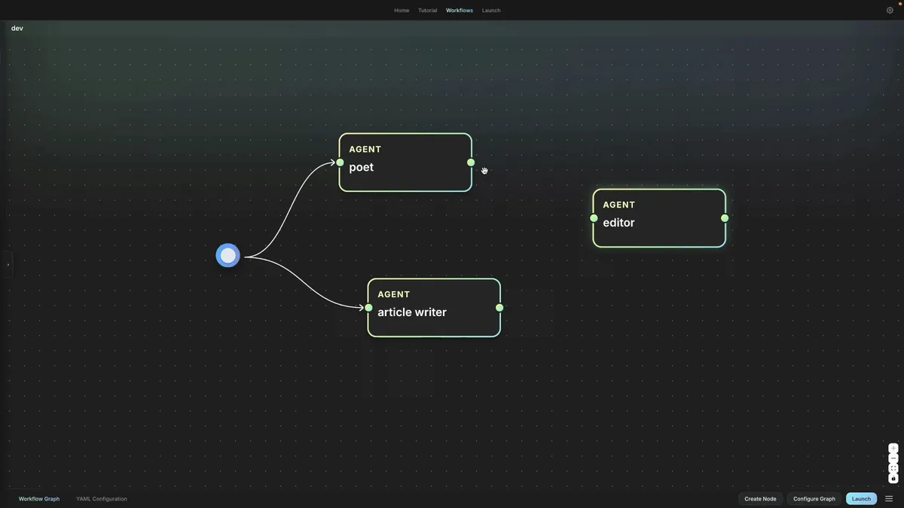
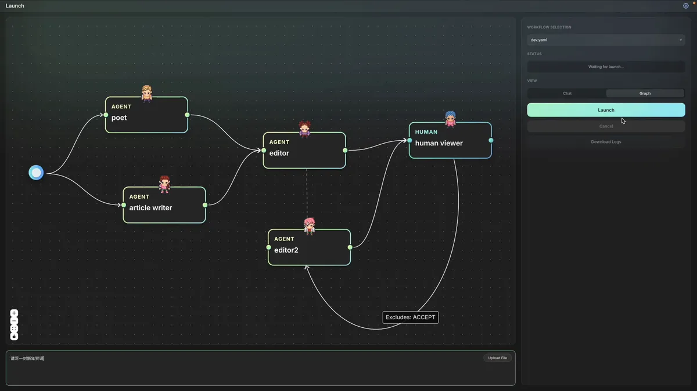
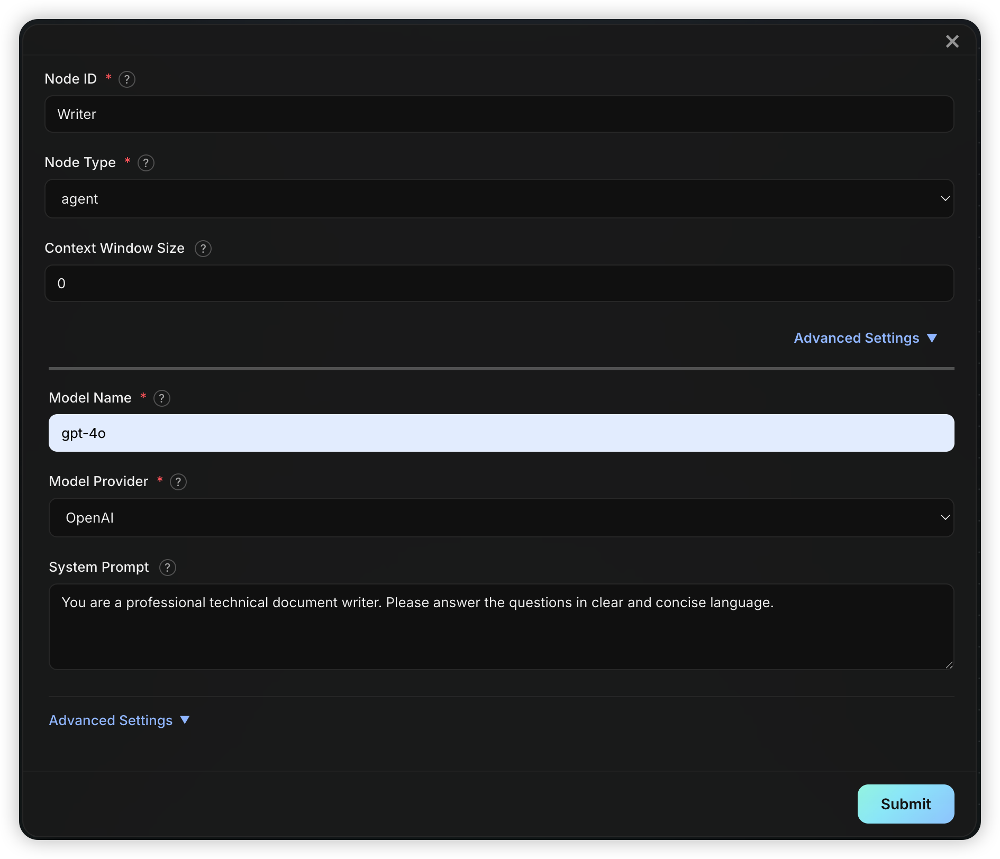
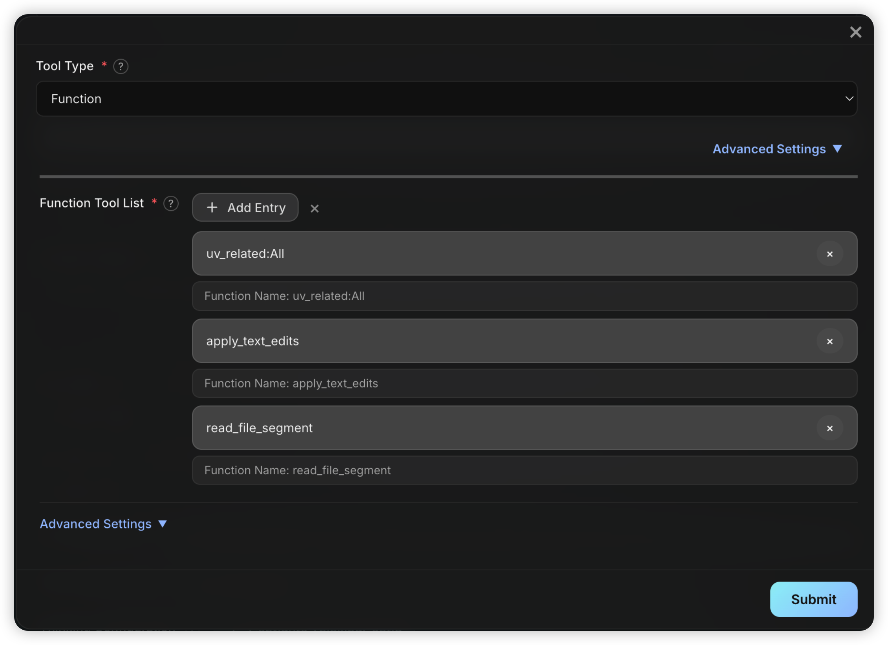
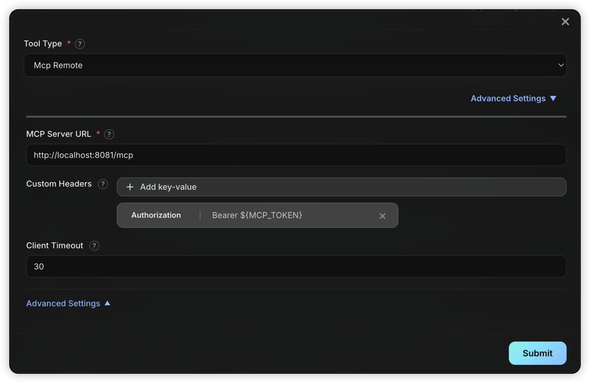
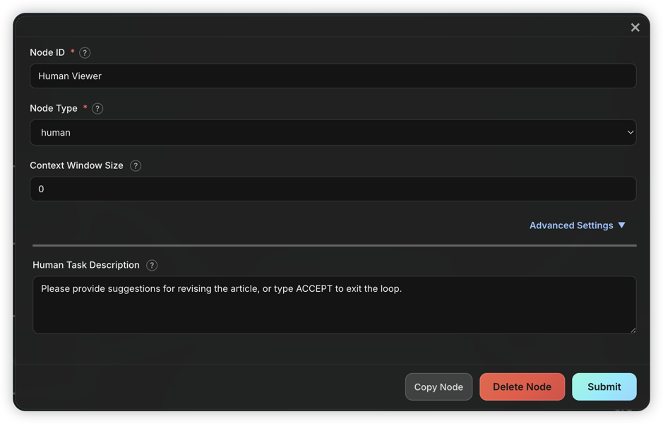
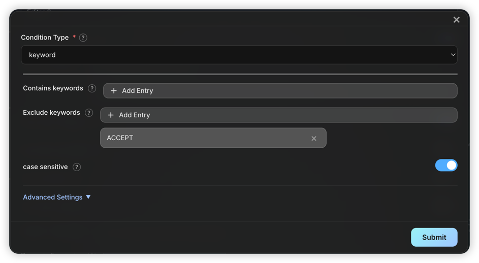
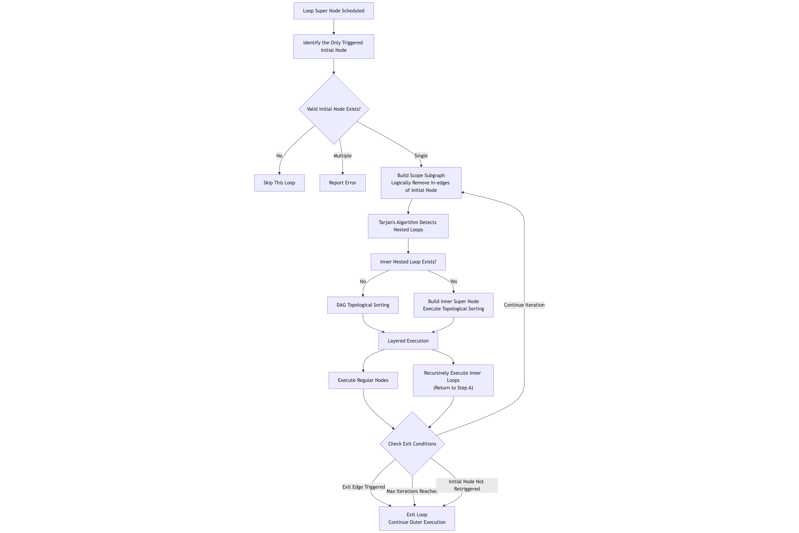
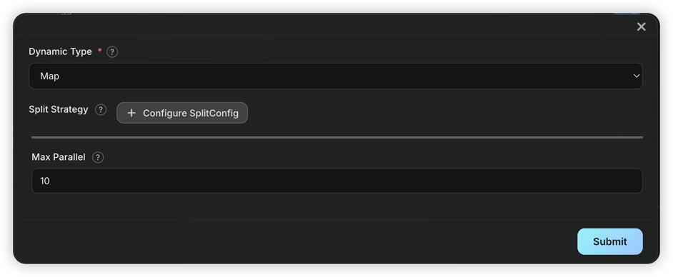

# AgentDev User Guide

AgentDev lets you build an "AI company": every employee is an **agent**, agents are arranged into a **workflow**, and you hand work to the whole team from a chat window. This guide follows the order in which you will actually use the app.

- [1. Basic concepts](#concepts)
- [2. Connect your accounts](#connections)
- [3. Skill library](#skill-library)
- [4. Build a workflow](#build-workflow)
  - [Create nodes](#2-create-nodes)
  - [Link nodes with edges](#what-is-an-edge)
  - [Team lead and members](#team-lead)
  - [Attach skills to an agent](#attach-skills)
  - [Example: an article workflow with edges](#example-linked-workflow)
- [5. The "Software company" template](#software-company)
- [6. Run a workflow](#run-page)
- [7. Laboratory](#lab)
- [Reference: node types](#node-types-explained)
- [Reference: edge configuration](#edge-configuration)
- [Reference: execution logic](#graph-execution-logic)
- [Reference: dynamic execution mode](#dynamic-execution-mode)
- [Reference: folder structure](#workspace-structure)

---

<a id="concepts"></a>
## 1. Basic concepts

| Term | Meaning |
|------|---------|
| **Workflow** | A YAML file that describes a team of agents and how they work together. Workflows are listed under **Workflows** in the top navigation bar. |
| **Node** | One step of a workflow. The most common type is **Agent**; there are also Human, Python, Literal, Passthrough, Loop counter and Subgraph nodes. |
| **Edge** | An arrow between two nodes: it passes the source node's output to the target node and can trigger the target to run. |
| **Agent** | A node that calls an AI model (Claude, Codex, Gemini) with its own role, prompt, tools and skills. |
| **Team lead** | The only agent that talks to you (for example a CTO, PM or CEO). The lead decides which member to delegate to, and when. |
| **Member** | An agent the lead may delegate to. Usually an agent node **with no edges**. |
| **Skill** | An instruction file (SKILL.md) that teaches an agent how to do one kind of work, such as planning or code review. Skills live in a shared library. |
| **Connection** | An AI account you signed in to (Claude, Codex/ChatGPT, Gemini). Each agent runs on one connection. |
| **Session** | One piece of work on the **Launch** page: the chat history, attachments and (optionally) a project folder. |

---

<a id="connections"></a>
## 2. Connect your accounts

Agents need an AI account to run. Open **Settings → Connections** (the gear button at the right of the top navigation bar).

1. Under **Providers**, pick a provider card and click **Connect**.
2. Choose how to sign in and follow the dialog:
   - **Anthropic Claude**: **Sign in with your account**, using the Claude CLI on this machine. If the machine is already signed in, just click **Connect**; otherwise click **Continue with Claude account**, open the sign-in link, sign in, paste the code into **Paste the code here** and click **Confirm**.
   - **OpenAI (Codex)**: **Sign in with ChatGPT** (opens the OpenAI sign-in page; Plus/Pro/Team plans) or **Use device code** (get a code and enter it in a browser, handy when the browser is not on the server machine).
   - **Google Gemini**: **Sign in with Google**. The server needs `GOOGLE_OAUTH_CLIENT_ID` and `GOOGLE_OAUTH_CLIENT_SECRET` in `.env`.
3. The new connection appears under **Your connections**. Click it to see the account, **Usage** (5-hour session, weekly...) and **Available models**.

Tips:

- **Make default**: every agent node without its own connection runs on the default one.
- **Test**: quickly checks the connection still works. If a run fails with an authentication error, test first.
- Credentials stay on your server and are never written to workflow files.
- If the Claude CLI or Codex CLI is not installed, the dialog tells you to install it first.

**Automatic account fallback.** When the account an agent is using reports it is out of usage (for example Claude's 5-hour limit), AgentDev moves that agent to another signed-in account, preferring another vendor (Claude → Codex, Codex → Claude, then Gemini), with that account's default model. A chat line and a pop-up tell you which account took over, and later agents in the same run use it straight away. If no account is left you get an error asking you to sign in to another one on **Connections**, so it is worth signing in to both Claude and Codex.

**General settings.** Under **Settings → General settings** you change the interface language (Tiếng Việt, English, 中文) and the light/dark theme. The same options are in the Settings dialog opened from the top navigation bar.

**Provider choice for an agent.** If an agent is set to a model from a vendor (for example OpenAI) that you are signed in to, AgentDev prefers the connection of that same vendor; if there is none, the agent runs on the default connection and the interface shows a notice.

---

<a id="skill-library"></a>
## 3. Skill library

Open **Settings → Skills**. This is the shared skill library: add a skill once, use it in every agent. Editing a skill updates every agent that uses it.

**Add a skill**

1. Click **Add skill**.
2. Paste the SKILL.md content into **Content** (with or without the `---` frontmatter), or click **Upload .md** / drop a `.md` file onto the box (256 KB max).
3. If there is no frontmatter, fill in **Name** (lowercase, digits, `-`) and **Description: use when**. The description matters: agents read it to decide when to load the skill.
4. Click **Save skill**. If the name already exists you are asked whether to **Overwrite** it.

**Import skills from Claude**

If you already have skills in `~/.claude/skills`, click **Import from Claude**. The **Import skills from a folder** dialog lists what it found; tick the skills (or **Select all**), turn on **Overwrite existing skills** to replace older copies, then click **Import**. You can change the **Source folder** and click **Reload**.

Each skill card has **Edit** and **Delete**. Skills that fail to parse are marked **Invalid**.

---

<a id="build-workflow"></a>
## 4. Build a workflow

Open **Workflows** in the top navigation bar. The list is on the left; click **Create Workflow** to start a new one, or pick an existing workflow to edit it.

The editor has two tabs:

- **Workflow Graph**: drag and drop nodes and edges.
- **YAML Configuration**: view and edit the YAML file directly.

The toolbar above the graph has:

- **Create Node**: opens the node form (or right-click an empty spot of the canvas to create a node there).
- **Configure Graph**: description, initial instruction, log level, memory, start and end nodes.
- **Launch**: opens the Launch page with this workflow.
- A menu (hover the icon at the end of the toolbar): **Rename Workflow**, **Copy Workflow**, **Manage Variables**, **Manage Memories**, **Create Edge**.

Turn on **Enable help tooltips** in **Settings** to get explanations when you hover nodes, edges and buttons.

**Workflow assistant.** The editor has a **Workflow assistant** panel: describe in words what you want to change (add a member, edit a prompt, link nodes...) and the assistant proposes changes to the workflow for you to review and apply. Conversations are saved as sessions and you can pick the assistant's model. It runs on your connected accounts, so it uses tokens.

<a id="2-create-nodes"></a>
### Create nodes

Click **Create Node**, choose the **Type** and fill in the form. For an **Agent** node the key fields are:

| Field | Meaning |
|-------|---------|
| **ID** | Unique node name, e.g. `Backend Developer`. The lead calls members by this ID. |
| **Description** | One sentence on what the node does. The lead reads it to pick the right member, so make it clear. |
| **Mascot** | The node's character on the graph, the Launch page and the Office. |
| **Account connection** | The account used to call the model. Leave empty to use the default connection. |
| **Model** | Pick from the models of the connected account, or choose **Enter another model name...** |
| **System Prompt** | The agent's role, job and working rules. |
| **Agent skills** | Skills ticked from the library (see [Attach skills](#attach-skills)). |
| **Team lead** | Makes the agent a team lead (see [Team lead and members](#team-lead)). |
| **Tooling** | Tools the agent may use: read/write files, run code, web search, MCP servers... |
| **Context Window** | How many earlier messages the agent keeps between runs. `-1` means unlimited. |

Less common fields are under **Advanced Settings** at the bottom of the form. Click **Submit** to save the node, **Copy Node** to duplicate it (the copy needs a new ID), or **Delete Node** to remove it together with its edges.

<a id="what-is-an-edge"></a>
### Link nodes with edges

An **edge** connects two nodes and does two things:

1. **Passes data**: the source node's output becomes the target node's input.
2. **Controls order**: when the source finishes, the edge can trigger the target to run.

To create one, drag from the connection dot on a node's side to another node, or use **Create Edge** in the menu. Click an edge to edit or delete it.

The **Start** node is where the workflow begins: every node connected to it receives your task and runs in parallel when the workflow starts. The start node must keep at least one edge.

For edge options (conditions, data-only edges, kept messages...) see [Reference: edge configuration](#edge-configuration).

<a id="team-lead"></a>
### Team lead and members

Instead of hard-wiring the order of steps with edges, you can build a **team** with a lead. The lead is the only agent that talks to you; while working, it decides which member to delegate to, how many times and in what order, then sums up the results for you.

How to set it up:

1. Create an agent node for the lead (e.g. `CTO`) and connect the start node to it.
2. Create agent nodes for the members. **Do not connect any edges** to them: the lead calls them when needed. Write a clear **Description** so the lead knows who does what.
3. Open the lead's form, configure the **Team lead** entry and fill in:

| Field | Meaning |
|-------|---------|
| **Lead a team** | Turn on to make this agent the lead. |
| **Members** | Node IDs of the agents the lead may delegate to. Empty = every agent node with no edges. |
| **Ask before building** | For new work, the lead presents a plan (stack, architecture, tasks) and waits for your approval, unless you said to go ahead. |
| **Max delegations per request** | (Advanced) Upper bound on delegations in one turn, to cap token use. |
| **Max fix/review rounds** | (Advanced) How many times failed work may go back for fixes before the lead reports to you. |

During a run the lead can **ask you questions** when the request is unclear. The question appears in the chat; just answer it. Delegations show up as lines such as "CTO assigned a task to Backend Developer" and "Backend Developer reported back to CTO".

<a id="attach-skills"></a>
### Attach skills to an agent

In the agent form, **Agent skills** lists the whole skill library. Tick the skills this agent should have; the count is shown at the top. Click **Manage library** to add or edit skills in a new tab. An agent only loads a skill's content when the task matches the skill's "use when" description.

<a id="example-linked-workflow"></a>
### Example: an article workflow with edges

The `demo_loop_counter` workflow shows how to chain nodes with edges:

1. Create three agent nodes: **Poet** (writes a poem), **Article Writer** (writes an article) and **Editor 1** (merges the two).
2. Connect the start node to Poet and Article Writer: they run in parallel.
3. Connect `Poet → Editor 1` and `Article Writer → Editor 1`: Editor 1 runs once both results arrive.



To add a review loop, create a **Human** node that asks "Give feedback on the article, or enter ACCEPT to finish", then use **conditional edges**: `ACCEPT` ends the run, anything else goes to **Editor 2** for another revision. See [Edge condition](#edge-condition).



---

<a id="software-company"></a>
## 5. The "Software company" template

The `software_company` workflow is a ready-made software company (web, web app, desktop) with a **CTO** as team lead and 11 members:

| Member | Main job |
|--------|----------|
| Project Manager | Requirements, user stories, acceptance criteria, task breakdown and schedule |
| Solution Architect | System analysis, architecture, module boundaries, APIs, design-level bugs |
| Data Engineer | Database schema, migrations, queries, data integrity and performance |
| Backend Lead | Backend technical lead, API design, backend code review |
| Backend Developer | Backend features and APIs with tests |
| Frontend Developer | Pages, components, state, API integration, responsive and accessible UI |
| UI UX Designer | UX flows, layout, design system and UI specs |
| Bug Fixer | Reproduces, finds the root cause of and fixes bugs, with a regression test |
| QA Tester | Tests against the acceptance criteria, reports pass/fail with evidence |
| Acceptance Reviewer | Final acceptance: does the result meet the request and the quality bar |
| DevOps Engineer | Build, CI/CD, environments, deployment and monitoring |

How it works: you only chat with the CTO. For a new project the CTO clarifies the goal, proposes the stack and architecture, splits the work and **presents the plan for your approval**. Once you agree, it delegates step by step: PM → architecture/design → implementation → QA → acceptance → DevOps (when deployment is in scope). For an existing project or a bug report, the CTO reads the code first and picks the right people. Questions that need no work are answered by the CTO directly.

Each member comes with suitable skills (for example the CTO uses `planning-and-task-breakdown` and `spec-driven-development`; the Acceptance Reviewer uses `code-review-and-quality` and `security-and-hardening`).

To customise it, open the workflow, use **Copy Workflow** to make your own version, then change models, account connections, skills, or add/remove members. Adding a member is just creating a new agent node with no edges and a clear description.

---

<a id="run-page"></a>
## 6. Run a workflow

Open **Launch** in the top navigation bar (or click **Launch** in the workflow editor).

**Run modes.** The input box has a **Mode** button; click it or press **Shift+Tab** in the input to cycle through the 4 modes. If a run is in progress, the new mode applies from the next message.

| Mode | Behavior |
|------|----------|
| **Ask first** | Runs exactly as designed: every question and approval step waits for you. |
| **Plan** | The lead always presents a plan and waits for your approval before delegating. |
| **Auto** | No plan approval needed, the lead's questions are answered automatically; approval steps in the workflow still wait for you. |
| **Bypass approvals** | Answers every question and approval step automatically. |

> **Paid steps.** A gate marked `paid: true` (for example Veo video rendering) is never approved automatically: not even in **Bypass approvals**, not on silence or timeout. It runs only when you approve it yourself. The Lab always refuses these gates.

**Cost and tokens.** Every run records each agent's tokens and estimated cost; before a paid step the app shows a cost estimate so you can decide. Cost appears in the **Dashboard** view.

**Pick a workflow and a project**

1. In the right panel, under **Workflow Selection**, pick the workflow (e.g. `software_company`).
2. To let agents work on an existing project, click **Add new project** at the bottom of the session list (left), or click the **+** button next to the input and choose **Open project folder**. In the **Open project folder** dialog, pick a folder on this machine (or type a path and press Enter) and click **Open folder**. Agents edit files **in place** in that folder, so use git to review and undo changes.
3. To attach files (documents, images, spreadsheets...), click **+** → **Upload File**, or drag files onto the chat.

**Chat with the lead**

Type the task into **Please enter task prompt...** and click **Launch**. With a team-lead workflow you talk to the lead like a person: answer its questions, approve the plan ("OK, go ahead") or ask for changes. When the workflow is waiting for you, the status shows **Waiting for you**; type your answer and click **Send**. **Relaunch** runs it again from the start.

The left list keeps every **session**, grouped by project. Click **New session** to start another one; sessions running in the background still notify you when they finish or need an answer.

**Views** (the **View** section of the right panel)

| View | What it shows |
|------|---------------|
| **Chat** | The whole conversation, each agent's output, result files. |
| **Graph** | The workflow graph with the running node highlighted. |
| **Office** | A 2D office: each agent is a character at its department desk, walking around when handing over or receiving work. Click a character to see its status, model and latest output. |
| **Tasks** | A task board by team or by step: what each agent is doing, has queued and has finished. |
| **Dashboard** | Progress, run time, model calls and tool use, a timeline and recent activity. |
| **Products** | The file tree the team produced (source code, web pages, documents). Click **Try it** to run the product and **View preview**; a preview stops by itself after 30 minutes and only a limited number can run at once. |
| **Review** | Accept or reject the result (see below). |

**Review results**

In **Review**, every finished run becomes an item **To review**. Open it to see your request, the delivered result, changed files and each agent's handover. Rate the quality, pick **Strengths** / **To fix**, write feedback, then click:

- **Accept** when it is good.
- **Request rework** when it is not. Turn on **Hand it straight back to the agent team with this feedback** to have the team redo it right away in the same project (round 2, 3...).

**Download Logs** gives you the detailed run log.

---

<a id="lab"></a>
## 7. Laboratory

The **Lab** validates a workflow before you rely on it. Choose it under **Workflow to validate**, then:

**1. Configuration check** (instant, no tokens). Each item is marked green (pass), amber (warning) or red (error): workflow structure, AI accounts, each agent's role, whether selected skills are in the library, whether tools exist, code/command execution permission, team lead and members, and nodes that can never run. Fix every red item before test runs.

**2. Test scenarios.** Each scenario has a **Request sent to the workflow** (what you would really type) and **Pass criteria** (what the answer must satisfy; empty means any error-free answer passes). **Add sample scenarios** fills two scenarios for the Software company template. Pick **Runs per scenario** (2–3 runs measure stability) and click **Start test run**. The workflow really runs on your accounts; questions it asks (such as plan approval) are answered "Approved" automatically (a paid gate, `paid: true`, is always refused, so that step never runs in the Lab), and an AI judge grades every answer with a reason.

Results show the pass rate, tokens, estimated cost, time, which agents took part, the questions asked and every answer. A workflow is **Passed** at an 80% pass rate or higher with no errored runs. Scenarios are remembered per workflow in your browser, so after editing the workflow you just run them again.

**Diagnosis, fix brief and products.** For each run, **Speed and quality diagnosis** points to slow or token-heavy steps and explains why an answer failed. From there click **Copy brief** to get a fix brief and paste it into the **Workflow assistant** in the editor. Each run also has **Products** and **Try it** parts to browse files and try the result; after validation the app asks whether to clean up previews and temporary data.

**Batch run from Excel/CSV.** The **Batch run** tab in the Lab (also reachable at `/batch-run`) runs one workflow on many inputs:

1. Pick the workflow under **Workflow Selection**.
2. Pick an `.xlsx` or `.csv` input file under **Input File Selection**. It needs at least a `task` and/or `attachments` column:
   - `id`: unique row ID (generated if the column is missing)
   - `task`: the task text
   - `vars`: a JSON object of global variables
   - `attachments`: a JSON array of absolute paths of attachments
3. Set **Max. Parallel Launches** and the log level, then click **Launch**.
4. Follow progress in the **Dashboard** or **Terminal** view; click **Download Logs** when done.

---

<a id="node-types-explained"></a>
# Reference: node types

<a id="agent-node"></a>
## Agent node

The main node type. It calls an AI model to write, code, analyse and decide. Agents can use tools, memory and skills, and can act as a team lead.



### Tools

Under **Tooling** you can add several tool sources at once:

**1. Local Python functions (function)**: functions in `workspace/functions/function_calling/`. An entry like `file:All` loads every function in `file.py`; other entries load a single function.



| Module | Main functions | Purpose |
|--------|----------------|---------|
| `file.py` | `save_file`, `read_file_segment`, `list_directory`, `search_in_files`... | Read/write project files |
| `code_executor.py` | `execute_code` | Run code |
| `shell.py` | `run_shell_command` | Run a command in the project folder (`npm test`, `npm run build`, `pytest`…) |
| `uv_related.py` | `install_python_packages`, `init_python_env`, `uv_run` | Python environment management |
| `web.py` | `web_search`, `read_webpage_content` | Web search and page reading |
| `deep_research.py` | `search_save_result`, `report_*` functions | Research and report writing |
| `user.py` | `call_user` | Ask the user |
| `utils.py` | `get_current_time`, `wait` | Utilities |

To add your own function: create a Python file in `workspace/functions/function_calling/`, annotate the parameters, write a docstring (the model reads it), then restart the backend.

```python
from typing import Annotated
from agentdev.utils.function_catalog import ParamMeta

def my_tool(
    param1: Annotated[str, ParamMeta(description="Parameter description")],
    *,
    _context: dict | None = None,  # optional, injected by the system, hidden from the model
) -> str:
    """Function description (shown to the model)"""
    return "result"
```

**2. MCP servers**: `mcp_remote` connects to an MCP server over HTTP; `mcp_local` starts a local MCP server over stdio (e.g. `uvx ...`).



### Memory

1. Open the menu → **Manage Memories** and add a memory store:

| Type | Behaviour | Use for |
|------|-----------|---------|
| `simple` | Stores earlier results, keyword retrieval (no API key needed); a local embedding model is optional | Conversation memory |
| `file` | Indexes local files/folders, read-only | Knowledge base |
| `blackboard` | Shared board many nodes read and write, for the current run only | Sharing information between nodes |

2. In the agent node, open **Memories**, pick the store, set read/write permissions and the retrieve stage.

Example: `workspace/workflows/demo_simple_memory.yaml`.

<a id="human-node"></a>
## Human node

Pauses the workflow and waits for your input: review, feedback, a decision or extra information. Its task description is the question shown to you.



> With a team-lead workflow you rarely need this node: the lead asks you itself when needed.

<a id="python-node"></a>
## Python node

Runs Python code on the machine. The node takes the ```` ```python ... ``` ```` block from its input (or the whole input if there is none), runs it in the session's `code_workspace/` folder and passes stdout on. You can set environment variables, startup arguments and a timeout.

For safety, Python execution is disabled by default. If you trust the workflow, set `MAC_ALLOW_UNSAFE_CODE_EXECUTION=1` in `.env` and restart the backend (code runs directly, without a sandbox). The same switch enables `run_shell_command`; it only runs inside the project folder and blocks dangerous commands such as wiping a drive, `git push` or `npm publish`. Images and PDFs you attach in the chat reach the agents (Claude opens them with its Read tool, Codex receives images directly); small text files are put into the prompt.

<a id="passthrough-node"></a>
## Passthrough node

Does nothing but forward messages. By default only the last message is forwarded (change it with **Only Last Message**). Common uses: keep the original task inside a loop (together with **Keep Message Input** on the edge) or filter out extra loop output.

<a id="literal-node"></a>
## Literal node

Outputs a fixed text and ignores its input; the message role can be `user` or `assistant`. Use it to inject fixed instructions or to test downstream nodes.

<a id="loop-counter-node"></a>
## Loop counter node

Limits how many times a loop runs. Each trigger adds 1; until the maximum is reached the node outputs nothing, then it emits its release message to leave the loop. Connect it both to a node inside the loop and to a node outside. The **Loop timer** node works the same way, based on time.

Example: `workspace/workflows/demo_loop_counter.yaml`.

<a id="subgraph-node"></a>
## Subgraph node

Embeds another workflow so it can be reused. The source type is `file` (a YAML path relative to `workspace/workflows/`) or `config` (defined inline). A subgraph inherits its parent's variables; its end nodes decide what it returns.

Examples: `workspace/workflows/software_company.yaml`, `workspace/workflows/marketing_agency.yaml`.

---

<a id="edge-configuration"></a>
# Reference: edge configuration

| Field | Default | Meaning |
|-------|---------|---------|
| **Condition** | always true | The edge is active only when the condition is true |
| **Trigger** | on | Off: the edge only passes data and does not make the target run |
| **Pass Data to Target** | on | Off: only triggers, passes no data |
| **Keep Message Input** | off | The message is not removed when the target trims its context |
| **Clear Context** | off | Clears the target's non-kept context before passing new data |
| **Clear Kept Context** | off | Also clears kept messages |
| **Payload Processor** | - | Transforms the content before passing it (regex, custom function) |
| **Dynamic Expansion** | - | See [dynamic execution mode](#dynamic-execution-mode) |

<a id="edge-condition"></a>
## Edge condition

- **Keyword** (`keyword`): contains keywords, exclude keywords, regular expressions. Exclusions take priority.
- **Function** (`function`): functions in `workspace/functions/edge/`, e.g. `true` (always), `code_pass`, `code_fail`, `always_false`.



<a id="payload-processor"></a>
## Payload processor

- `regex_extract`: extract with a Python regex (pattern, capture group, output template using `{match}`, no-match behaviour: `pass` / `default` / `drop` / `empty`).
- `function`: call a function in `workspace/functions/edge_processor/`, e.g. `uppercase_payload`, `code_save_and_run`.

Restart the backend after adding a new condition or processor function.

---

<a id="graph-execution-logic"></a>
# Reference: execution logic

<a id="dag-execution"></a>
## Workflows without loops

Nodes are ordered by their dependencies (topological sort). Nodes with nothing left to wait for run first; nodes on the same layer run in parallel.

<a id="loop-graph-execution"></a>
## Workflows with loops

AgentDev uses Tarjan's algorithm to find loops, wraps each loop into a "super node" and runs the result like a loop-free workflow. Inside each loop:

1. Find the single entry node triggered from outside (more than one is a configuration error).
2. Temporarily drop the edges into the entry node to find nested loops, then run layer by layer, recursively.
3. Exit when an edge leaving the loop is triggered, when the maximum number of rounds is reached (100 by default), or when the entry node is not triggered again.



> Team-lead workflows need no loops: the lead sends failed work back for fixes itself, up to **Max fix/review rounds** times.

**Several end nodes.** With several end nodes, the end node that finishes **last** with output gives the final answer (ties: declaration order). The linter warns `MULTIPLE_END_NODES` when two end nodes can run in the same turn; prefer mutually exclusive end nodes.

**Failing edge conditions.** A condition that errors while evaluating does not fire its edge and raises a warning. An edge inside a **Loop Counter** loop must point back to the loop-entry step.

---

<a id="dynamic-execution-mode"></a>
# Reference: dynamic execution mode

Configured on an edge (**Dynamic Expansion**) to split data into parts and run the target node in parallel:

| Mode | How it runs | Output |
|------|-------------|--------|
| **Map** | Split, run in parallel | A list of results |
| **Tree** | Split, run in parallel, then merge over several rounds | One result |

**Split strategy**: `message` (one part per message, default), `regex` (one part per regex match), `json_path` (one part per JSON array item). Messages arriving over normal (non-dynamic) edges are copied to every parallel run.



---

<a id="workspace-structure"></a>
# Reference: folder structure

| Path | Contents |
|------|----------|
| `workspace/workflows/` | Workflow YAML files |
| `workspace/skills/` | The shared skill library |
| `workspace/functions/` | Tool functions, edge condition and processor functions |
| `storage/warehouse/<session>/` | Data for one session |
| `storage/warehouse/<session>/code_workspace/` | Working folder for code and uploaded files (`attachments/`) |
| `storage/warehouse/<session>/execution_logs.json` | Execution log |
| `storage/warehouse/<session>/node_outputs.yaml` | Output of each node |
