# Xây dựng quy trình đa Agent dạng đồ thị đầu tiên

[Xem nhanh](http://localhost:5173/workflows/net_example_en)

Ví dụ ở trên minh họa một quy trình đa Agent dùng để **sáng tác nội dung**.
Hướng dẫn này sẽ chỉ cho bạn cách dùng cấu trúc **Đồ thị (Graph)** để tổ chức nhiều nút Agent, hoàn thành trọn vẹn quá trình từ tạo nội dung, biên tập cho đến duyệt bởi con người. Làm theo các bước dưới đây, bạn sẽ xây dựng được quy trình đa Agent dạng đồ thị đầu tiên của mình.

- [1. Tạo đồ thị](#1-create-a-graph)
  - [Đồ thị là gì?](#what-is-a-graph)
  - [Biến là gì?](#what-is-a-variable)
- [2. Tạo nút](#2-create-nodes)
  - [Nút là gì?](#what-is-a-node)
  - [Tạo các nút Agent](#creating-agent-nodes)
- [3. Truyền thông tin giữa các nút](#3-transfer-information-between-nodes)
  - [Message là gì?](#what-is-a-message)
  - [Liên kết là gì?](#what-is-an-edge)
  - [Kết nối các nút](#establishing-node-connections)
- [4. Khởi động và logic thực thi của đồ thị](#4-graph-startup-and-execution-logic)
  - [Nút đầu vào](#entry-nodes)
- [5. Xây dựng vòng lặp duyệt và chỉnh sửa](#5-build-review-and-revise-loop)
  - [Tạo nút biên tập thứ hai](#creating-a-second-editing-node)
  - [Thiết lập cửa sổ ngữ cảnh](#set-the-context-window)
  - [Nút Human: đưa con người tham gia vào quy trình](#human-node-introducing-human-in-the-loop)
- [Tìm hiểu thêm](#more-things)
---

<a id="1-create-a-graph"></a>
## 1. Tạo đồ thị

<a id="what-is-a-graph"></a>
### Đồ thị là gì?

**Đồ thị (Graph)** là nơi chứa và cấu trúc điều phối việc thực thi của hệ thống đa Agent. Nó mô tả quan hệ phụ thuộc và thứ tự thực thi giữa các nút (Agent), về bản chất chính là một **quy trình hoàn chỉnh**.

Bản thân đồ thị không trực tiếp thực hiện công việc cụ thể nào, mà chịu trách nhiệm tổ chức, sắp xếp và điều phối logic thực thi của từng nút.


---

<a id="what-is-a-variable"></a>
### Biến là gì?

**Biến (Variable)** cung cấp các tham số toàn cục hoặc cục bộ có thể cấu hình cho đồ thị. Sau khi được định nghĩa, các nút (Agent) có thể tham chiếu trực tiếp tới những biến này, giúp chia sẻ tham số và tách rời phần cấu hình.

Nên quản lý tập trung tại đây các cấu hình dùng chung hoặc nhạy cảm, chẳng hạn như ngôn ngữ đầu ra. Quyền dùng model lấy từ kết nối tài khoản chọn ở từng nút agent (trang Kết nối).

Lưu ý: nếu các biến môi trường cần thiết đã được định nghĩa trong tệp `.env` bên ngoài và bạn muốn dùng trực tiếp, thì không cần cấu hình lại ở đây.
Nếu biến được cấu hình tại đây, **thiết lập này sẽ được ưu tiên** hơn giá trị trong tệp `.env` bên ngoài.

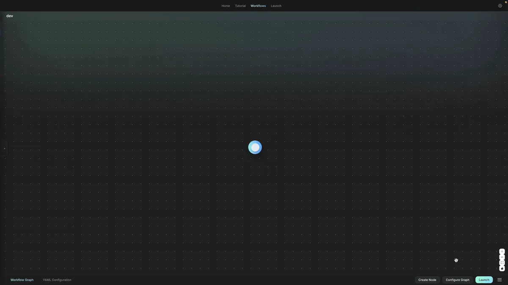

---

<a id="2-create-nodes"></a>
## 2. Tạo nút

<a id="what-is-a-node"></a>
### Nút là gì?

**Nút (Node)** là đơn vị thực thi nhỏ nhất trong đồ thị, thường tương ứng với một Agent.
Mỗi nút nên có năng lực tương đối độc lập và trách nhiệm rõ ràng.

---

<a id="creating-agent-nodes"></a>
### Tạo các nút Agent

Trong đồ thị ví dụ này, chúng ta tạo ba nút sau:

* **Poet** (Nhà thơ): chịu trách nhiệm sáng tác thơ hoặc nội dung sáng tạo
* **Article Writer** (Người viết bài): chịu trách nhiệm viết bài có cấu trúc
* **Editor 1** (Biên tập viên 1): chịu trách nhiệm biên tập ban đầu và tổng hợp nội dung

Tất cả các nút trên đều là **nút Agent**. Dưới đây, chúng ta lấy nút *Poet* làm ví dụ để minh họa toàn bộ quá trình tạo một nút Agent.

#### Lời nhắc (sao chép để cấu hình)

Dùng các lời nhắc sau làm trường `role` cho từng nút Agent.

**Poet**

```
You are a poet who crafts a modern English poem based on a single word or short phrase.
The user will input a word or short phrase. Write a modern English poem inspired by it.
```

**Article Writer**

```
You are a writer who excels at generating a full article from a single word or short phrase.
The user will input a word or short phrase, and you must produce an article of at least 2000 words with multiple paragraphs.
```

**Editor 1**

```
You are an editor. Combine the article and the poem, and append the poem at the end of the article.
```

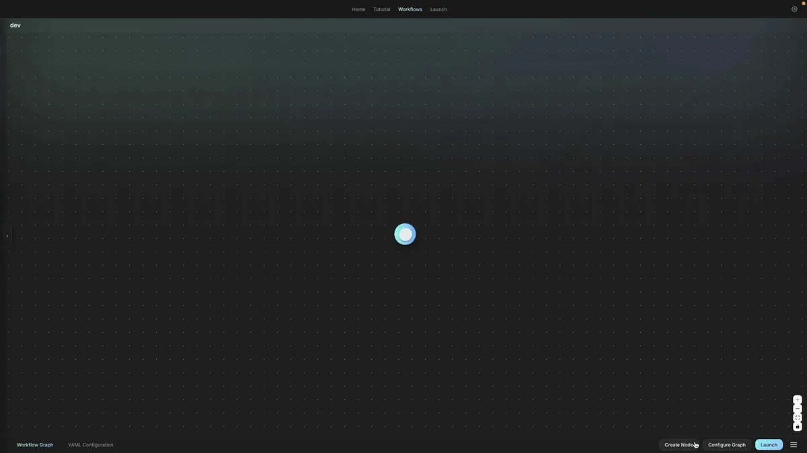

---

<a id="3-transfer-information-between-nodes"></a>
## 3. Truyền thông tin giữa các nút

<a id="what-is-a-message"></a>
### Message là gì?

**Message** (thông điệp) là đơn vị cơ bản để truyền và lưu trữ thông tin, là đơn vị cơ bản để kiểm soát ngữ cảnh, đồng thời cũng là đơn vị cơ bản để liên kết xử lý và điều khiển.

* Message có thể truyền văn bản và thông tin đa phương thức.
* Đầu vào và đầu ra của một nút có thể gồm nhiều message.
* Đầu vào ban đầu của người dùng là một message duy nhất.
* Khi liên kết chưa được cấu hình **[Chế độ thực thi động](#dynamic-execution-mode)** (tạm thời có thể bỏ qua), đầu ra của mọi loại nút, ngoại trừ **[nút Passthrough](#passthrough-node)** và **[nút Đồ thị con](#subgraph-node)** (khi đồ thị con kết thúc bằng một nút Passthrough), đều là một message duy nhất. Mọi cấu hình trong hướng dẫn này đều chỉ tạo ra một message đầu ra.

<a id="what-is-an-edge"></a>
### Liên kết là gì?

**Liên kết (Edge)** nối các nút với nhau, với các chức năng cốt lõi gồm:

1. **Truyền thông tin**: chuyển đầu ra của nút phía trước thành đầu vào cho nút phía sau
2. **Điều khiển thực thi**: xác định quan hệ phụ thuộc và quan hệ kích hoạt giữa các nút

> **Lưu ý**: Nếu nút phía trước xuất ra nhiều message, liên kết sẽ đánh giá, xử lý và truyền **từng message một**.

---

<a id="establishing-node-connections"></a>
### Kết nối các nút

Dựa trên ba nút vừa tạo, hãy thiết lập các liên kết sau:

* `Poet → Editor 1`
* `Article Writer → Editor 1`

Lúc này, đồ thị tạo thành một cấu trúc điển hình "tạo nội dung song song → tổng hợp biên tập".

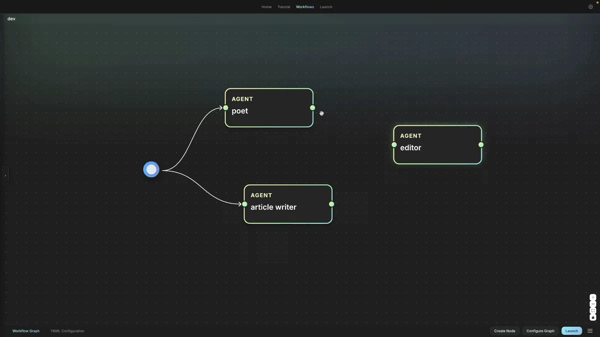

---
<a id="4-graph-startup-and-execution-logic"></a>
## 4. Khởi động và logic thực thi của đồ thị

<a id="entry-nodes"></a>
### Nút đầu vào

Khi đồ thị khởi động:

* Mọi nút được nối với nút **start** đều được coi là **nút đầu vào** của quy trình
* Các nút này nhận đầu vào của người dùng **cùng lúc** khi khởi động và thực thi **song song**
* Một quy trình có thể có nhiều nút đầu vào; bạn chỉ cần kéo thả để tạo liên kết nối với nút **start**

Vì vậy, với thiết lập hiện tại, **Poet** và **Article Writer** sẽ chạy song song, như hình dưới đây.

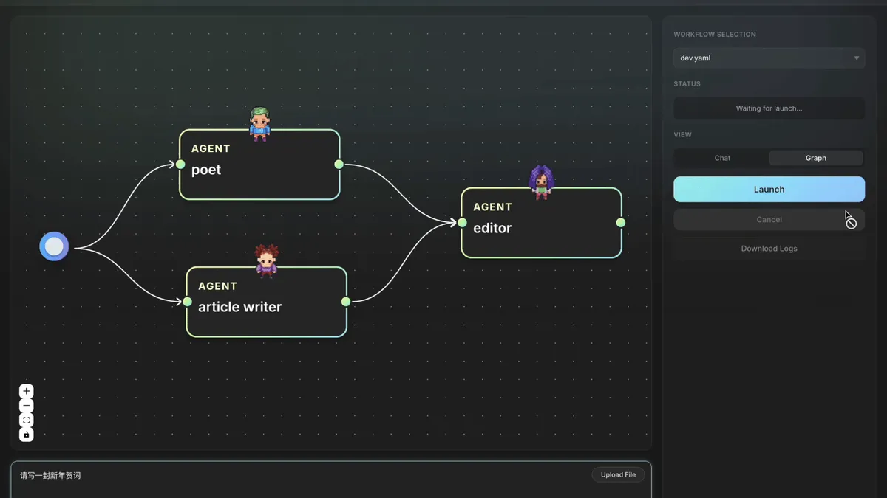

> Đến đây, bạn đã xây dựng xong một quy trình đa Agent tối giản.

---

<a id="5-build-review-and-revise-loop"></a>
## 5. Xây dựng vòng lặp duyệt và chỉnh sửa

<a id="creating-a-second-editing-node"></a>
### Tạo nút biên tập thứ hai

Tiếp theo, chúng ta tạo một nút Agent mới là **Editor 2**, chịu trách nhiệm chỉnh sửa và trau chuốt nội dung dựa trên góp ý của con người.

Sau đó thiết lập liên kết sau:

* `Editor 1 → Editor 2` (`trigger = false`)

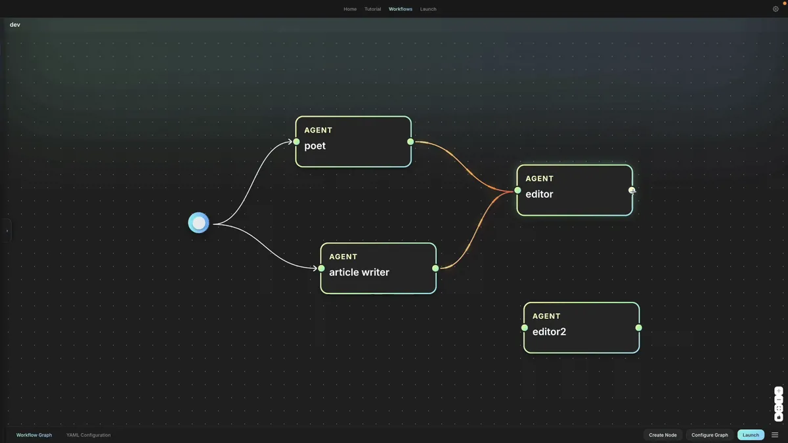

Cấu hình này liên quan đến một thuộc tính quan trọng của liên kết: `trigger`

* `trigger` quyết định nút đích có được thực thi hay không
* Khi liên kết đang hoạt động và `trigger = true`, nút đích được đánh dấu là cần kích hoạt và sẽ thực thi khi quá trình thực thi đến tầng chứa nút đó

**Lời nhắc cho Editor 2 (sao chép để cấu hình)**

```
You are an editor skilled at integrating and polishing an article.
Based on the article and the revision suggestions, refine and revise the article. Output only the revised article.
```

---
<a id="set-the-context-window"></a>
### Thiết lập cửa sổ ngữ cảnh

Để Agent có bộ nhớ ngữ cảnh, hãy thiết lập trên **Editor 2**:

* `Context Window Size = 7`

Thiết lập này giữ lại 7 message mới nhất (bao gồm cả message đầu vào và đầu ra của nút).

#### Cửa sổ ngữ cảnh là gì?

Trong AgentDev, **cửa sổ ngữ cảnh (context window)** là một **chính sách lưu giữ ở cấp nút**. Sau mỗi lần chạy, nút sẽ cố gắng dọn hàng đợi message đầu vào của chính nó, chỉ giữ lại những gì thỏa mãn quy tắc lưu giữ để kiểm soát kích thước ngữ cảnh. Việc này không ảnh hưởng đến lần chạy hiện tại; nó chỉ ảnh hưởng đến đầu vào mà nút nhìn thấy ở các lần chạy sau.

**Quy tắc** (cấu hình qua trường `Context Window Size` của nút):
* `0`: xóa toàn bộ ngữ cảnh, chỉ giữ lại các message được đánh dấu bằng `Keep Message Input = True` trên liên kết.
* `-1`: giữ lại tất cả message.
* `> 0`: giữ lại N message mới nhất (các message được giữ cố định vẫn được tính vào giới hạn).
* Khi `Context Window Size != 0`, hệ thống tự động lưu các message đầu ra của nút vào ngữ cảnh của chính nút đó để dùng cho các lần chạy sau.

**Mẹo**:
* Với ngữ cảnh cần giữ lâu dài, hãy dùng `Keep Message Input` trong cấu hình liên kết hoặc dùng mô-đun Bộ nhớ.

---

<a id="human-node-introducing-human-in-the-loop"></a>
<a id="human-node-introducing-human-in-the-Loop"></a>
### Nút Human: đưa con người tham gia vào quy trình

**Nút Human** là một loại nút đặc biệt, cho phép con người tham gia vào luồng thực thi của đồ thị.
Bản thân nút này không tạo ra nội dung; thay vào đó, nó đóng vai trò **nút điều khiển luồng**, tiếp nhận và xử lý đầu vào, góp ý của con người để tác động đến các nhánh thực thi tiếp theo.

Các trường hợp sử dụng phổ biến:

* **Duyệt nội dung**: con người kiểm tra và phê duyệt kết quả được tạo ra
* **Ra quyết định và xác nhận**: để con người quyết định ở các bước quan trọng
* **Điều khiển nhánh thực thi**: chọn nhánh đi tiếp của quy trình dựa trên góp ý của con người

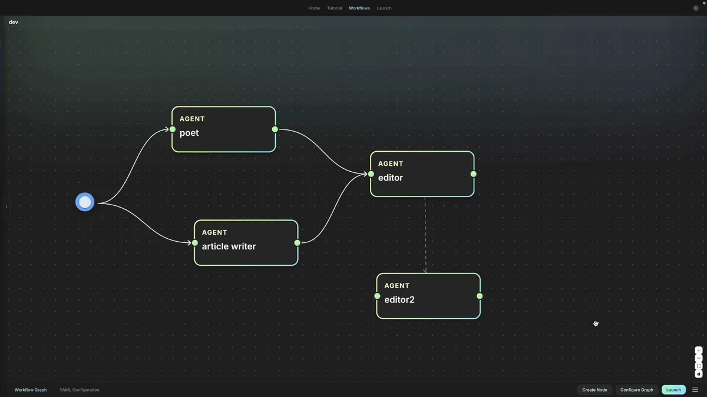

**Hướng dẫn cho nút Human (sao chép để cấu hình)**

Dùng đoạn văn bản sau làm trường `description` cho nút Human.

```
Please provide revision suggestions for the article, or enter ACCEPT to exit the loop.
```

Trong ví dụ này, chúng ta muốn dựa vào đầu vào mà nút Human nhận được để quyết định có cần bước biên tập thứ hai hay không:

* Khi nút Human nhận được `ACCEPT`, kết quả được coi là đã duyệt và không cần `editor2` chỉnh sửa thêm
* Ngược lại, quy trình sẽ chuyển sang `editor2` để chỉnh sửa tiếp

Để hiện thực logic này, chúng ta cần cấu hình **liên kết có điều kiện** giữa các nút.

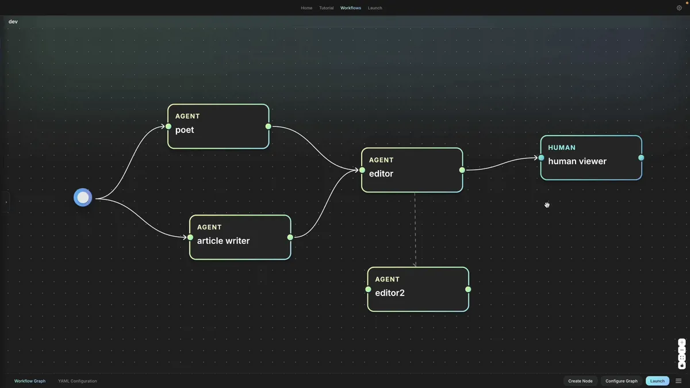

Cấu hình ở trên sử dụng một thuộc tính quan trọng của liên kết: `condition`, dùng để quyết định liên kết có hoạt động hay không:

* Khi `condition` được đánh giá là `true`, liên kết hoạt động và quy trình có thể đi tiếp theo nhánh này
* Khi `condition` là `false`, liên kết được coi như bị ngắt và không có tác dụng gì đối với nút phía sau

---

Với các bước trên, chúng ta đã bổ sung một quy trình duyệt và chỉnh sửa phức tạp hơn. Luồng thực thi được minh họa như dưới đây.
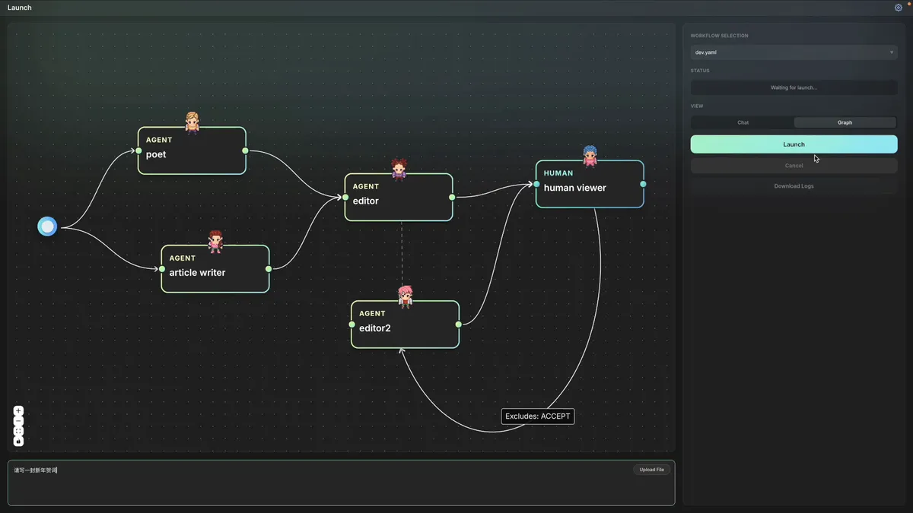

---
Dưới đây là thông tin chi tiết hơn về hệ thống:

<a id="more-things"></a>
## Tìm hiểu thêm

Chúng tôi cung cấp sẵn một bộ ví dụ: các tệp có tên dạng `demo_*.yaml` là bản minh họa cho từng tính năng/mô-đun, còn các tệp được đặt tên trực tiếp (ví dụ `AgentDev_v1.yaml`) là các quy trình tự phát triển hoặc được dựng lại.

- [Giải thích các loại nút](#node-types-explained)
  - [Nút Agent](#agent-node)
  - [Nút Human](#human-node)
  - [Nút Python](#python-node)
  - [Nút Passthrough](#passthrough-node)
  - [Nút Literal](#literal-node)
  - [Nút Loop Counter](#loop-counter-node)
  - [Nút Đồ thị con (Subgraph)](#subgraph-node)
- [Cấu hình liên kết](#edge-configuration)
- [Logic thực thi của đồ thị](#graph-execution-logic)
  - [Thực thi DAG](#dag-execution)
  - [Thực thi đồ thị có vòng lặp](#loop-graph-execution)
- [Cấu trúc không gian làm việc](#workspace-structure)
- [Chế độ thực thi động](#dynamic-execution-mode)

<a id="node-types-explained"></a>
# Giải thích các loại nút

AgentDev cung cấp nhiều loại nút, mỗi loại có mục đích và tùy chọn cấu hình riêng.

<a id="agent-node"></a>
## Nút Agent

Nút Agent là loại nút cốt lõi, dùng để gọi mô hình ngôn ngữ lớn (LLM) cho việc tạo văn bản, hội thoại, suy luận, v.v. Nút hỗ trợ nhiều nhà cung cấp mô hình (OpenAI, Gemini, Anthropic Claude, v.v.) và có thể cấu hình gọi công cụ, bộ nhớ cùng các tính năng nâng cao khác.

### Ví dụ cấu hình cơ bản

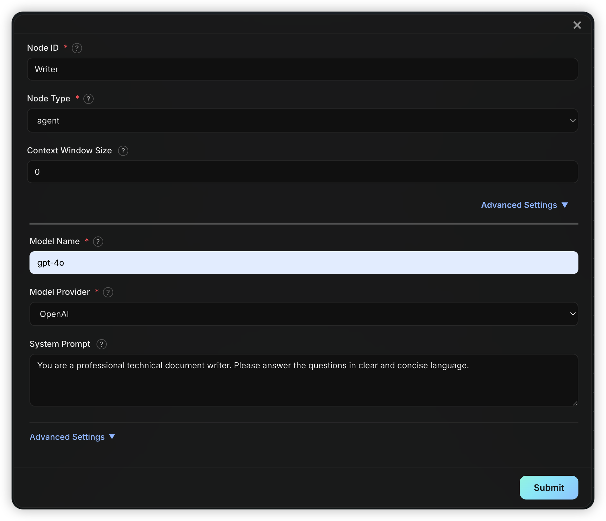

### Công cụ (Tooling)

Nút Agent có thể được cấu hình công cụ, cho phép mô hình gọi API bên ngoài hoặc thực thi hàm. Nhấn **Cài đặt nâng cao** để xem các tùy chọn. Có thể cấu hình nhiều công cụ cùng lúc, chẳng hạn vừa có công cụ MCP vừa có công cụ Function, hoặc nhiều công cụ MCP.
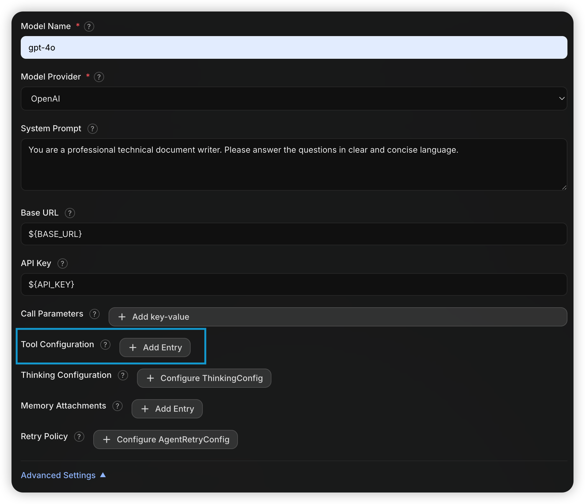

AgentDev hỗ trợ hai loại công cụ:

#### 1. Function Tooling (hàm cục bộ)

Gọi các hàm Python có trong kho mã (nằm trong `workspace/functions/function_calling/`):

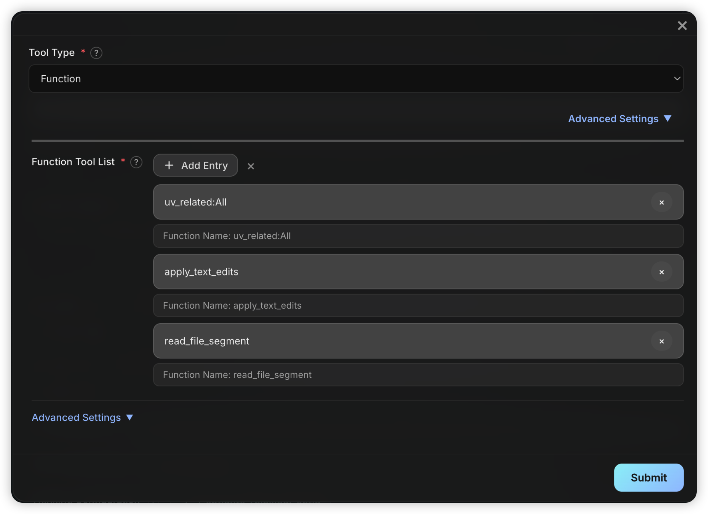

`uv_related:All` trong hình có nghĩa là nạp tất cả các hàm trong `workspace/functions/function_calling/uv_related.py`. Các mục còn lại nạp từng hàm cụ thể.

Để thêm hàm tùy chỉnh, hãy tạo một tệp Python trong `workspace/functions/function_calling/` và dùng chú thích kiểu (type annotation) cho các tham số:

```python
from typing import Annotated
from agentdev.utils.function_catalog import ParamMeta

def my_tool(
    param1: Annotated[str, ParamMeta(description="Parameter description")],
    *,
    _context: dict | None = None,  # Optional, for accessing context. The system injects this automatically and does not expose it to the model. See workspace/functions/function_calling/file.py for usage.
) -> str:
    """Function description (will be shown to LLM)"""
    # The return value can be any type; the system will convert it to a string for the model.
    # If the return value is MessageBlock or List[MessageBlock], multimodal information can be passed to the model (see load_file in workspace/functions/function_calling/file.py)
    return "result"
```

Trong đoạn mã trên: `_context` là tham số không bắt buộc, dùng để truy cập ngữ cảnh; hệ thống tự động truyền vào và không hiển thị cho mô hình (xem cách dùng trong `workspace/functions/function_calling/file.py`). Docstring của hàm sẽ được hiển thị cho LLM. Giá trị trả về có thể là kiểu bất kỳ, hệ thống sẽ chuyển thành chuỗi cho mô hình; nếu trả về `MessageBlock` hoặc `List[MessageBlock]` thì có thể truyền thông tin đa phương thức cho mô hình (xem `load_file` trong `workspace/functions/function_calling/file.py`).

Sau khi thêm, hãy khởi động lại máy chủ backend để dùng hàm này trong nút Agent.

#### Tra cứu nhanh các công cụ có sẵn

Hệ thống có sẵn một số công cụ có thể dùng trực tiếp trong nút Agent:

| Mô-đun | Hàm chính | Mô tả | Ví dụ |
|--------|--------------|-------------|---------|
| **file.py** | `save_file`, `load_file`, `list_directory`, `search_in_files`, v.v. | Thao tác với tệp | [AgentDev_v1](http://localhost:5173/workflows/AgentDev_v1) |
| **uv_related.py** | `install_python_packages`, `init_python_env`, `uv_run` | Quản lý môi trường Python | [AgentDev_v1](http://localhost:5173/workflows/AgentDev_v1) |
| **deep_research.py** | `search_save_result`, chuỗi hàm `report_*` | Nghiên cứu chuyên sâu và tạo báo cáo | [deep_research_v1](http://localhost:5173/workflows/deep_research_v1) |
| **web.py** | `web_search`, `read_webpage_content` | Tìm kiếm web và lấy nội dung trang | [deep_research_v1](http://localhost:5173/workflows/deep_research_v1) |
| **video.py** | `render_manim`, `concat_videos` | Dựng video bằng Manim | [teach_video](http://localhost:5173/workflows/teach_video) |
| **code_executor.py** | `execute_code` | Thực thi mã | - |
| **user.py** | `call_user` | Tương tác với người dùng | - |

> Tài liệu đầy đủ về công cụ xem tại `docs/user_guide/en/modules/tooling/function_catalog.md`

#### 2. MCP Tooling (dịch vụ bên ngoài)

Kết nối tới các dịch vụ bên ngoài tuân theo Model Context Protocol:

**Chế độ Remote** (kết nối tới một dịch vụ HTTP đã được triển khai):
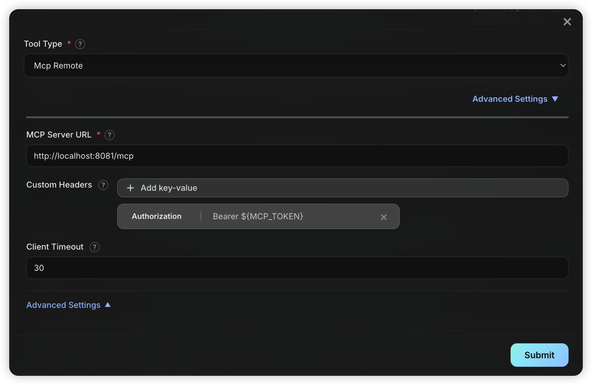
Header Authorization trong hình là không bắt buộc, bạn có thể điền khi cần.

**Chế độ Local** (khởi chạy một tiến trình cục bộ):
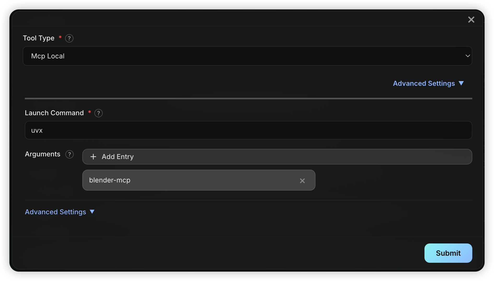

### Mô-đun Bộ nhớ (Memory)

Mô-đun Bộ nhớ cho phép Agent truy xuất và lưu trữ thông tin, có hỗ trợ kiểm soát quyền đọc/ghi.

#### Các bước cấu hình

1. Khai báo một Memory Store (kho bộ nhớ) ở cấp đồ thị:

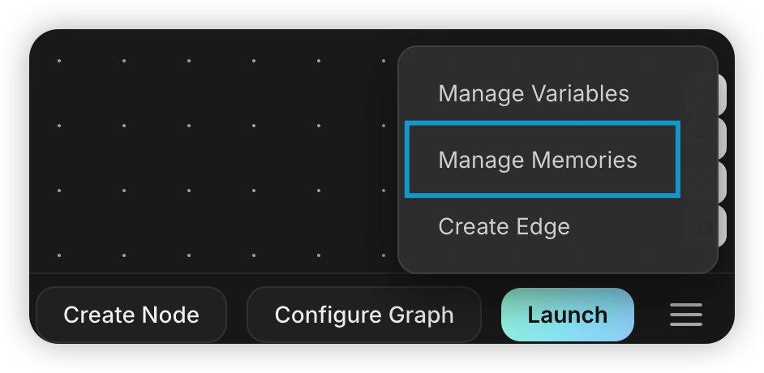

Di chuột lên biểu tượng ba gạch ở góc dưới bên phải trang quy trình, nhấn **Quản lý bộ nhớ** (Manage Memories) và thêm một Memory Store mới. Ở đây chúng ta thêm một SimpleMemory Store tên là `Paper Gen Memory` để lưu bộ nhớ hội thoại.

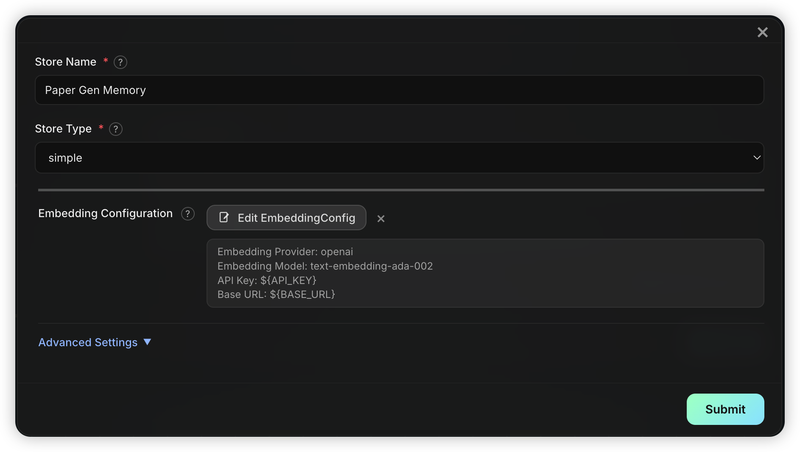

SimpleMemory cần cấu hình Embedding. Nhấn **Embedding Configuration**, chọn một Embedding Provider (hiện chỉ hỗ trợ openai, người dùng có thể tự mở rộng) và chỉ định mô hình (ví dụ `text-embedding-3-small`).

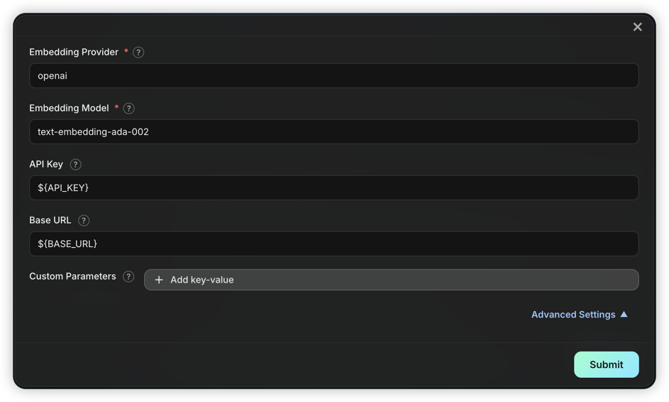

Có ba loại bộ nhớ có sẵn:

| Loại        | Đặc điểm                        | Trường hợp dùng         | Cần Embedding | Cấu hình ví dụ                        |
|-------------|---------------------------------|------------------|----------------|---------------------------------------|
| `simple`    | Tìm kiếm vector + xếp hạng lại theo ngữ nghĩa | Bộ nhớ hội thoại | Có            | workspace/workflows/demo_simple_memory.yaml |
| `file`      | Chỉ mục vector cho tệp/thư mục, chỉ đọc | Cơ sở tri thức   | Có            | workspace/workflows/demo_file_memory.yaml   |
| `blackboard`| Nhật ký đơn giản, cắt theo thời gian/độ dài  | Bảng tin chung  | Không             | workspace/workflows/subgraphs/reflexion_loop.yaml |

2. Tham chiếu trong nút Agent:
Nhấn **Memory Attachments**, chọn Memory Store, rồi cấu hình quyền đọc/ghi và giai đoạn truy xuất.

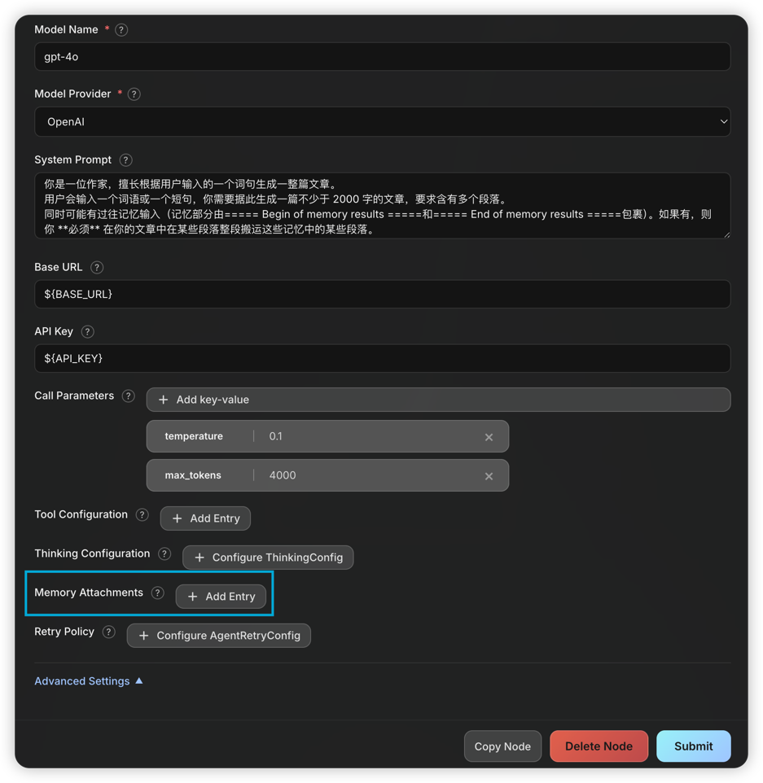

Top K quyết định số kết quả trả về mỗi lần truy xuất; Read/Write quyết định nút có được đọc/ghi bộ nhớ hay không; Retrieve Stage quyết định truy xuất ở những giai đoạn thực thi nào (có thể chọn nhiều; các giai đoạn còn lại dành cho giai đoạn Suy luận (Thinking), hiện chưa dùng; ở đây chúng ta chỉ chọn Gen Stage).

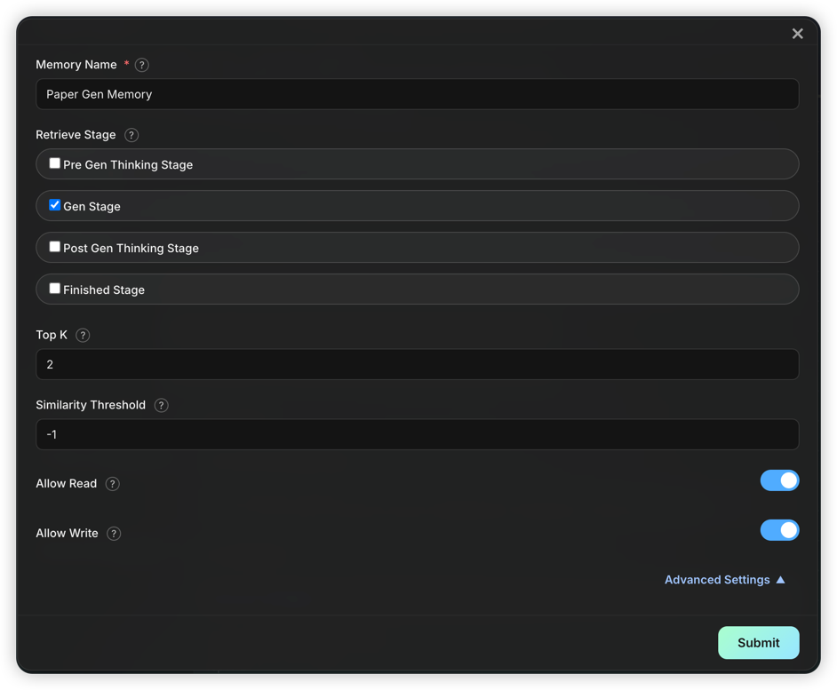

---

<a id="human-node"></a>
## Nút Human

Nút Human đưa tương tác của con người vào quy trình. Khi nút này được thực thi, quy trình sẽ tạm dừng và chờ người dùng nhập liệu.


**Công dụng điển hình:**
- Duyệt và xác nhận nội dung
- Thu thập góp ý
- Các điểm cần ra quyết định quan trọng
- Bổ sung dữ liệu

---

<a id="python-node"></a>
## Nút Python

Nút Python thực thi các tập lệnh Python. Tập lệnh chạy trong thư mục `code_workspace/`. Thường dùng để thực thi mã do Agent tạo ra; nếu muốn chạy mã của riêng bạn, hãy thêm một nút Literal để xuất ra mã và nối nó với nút Python.

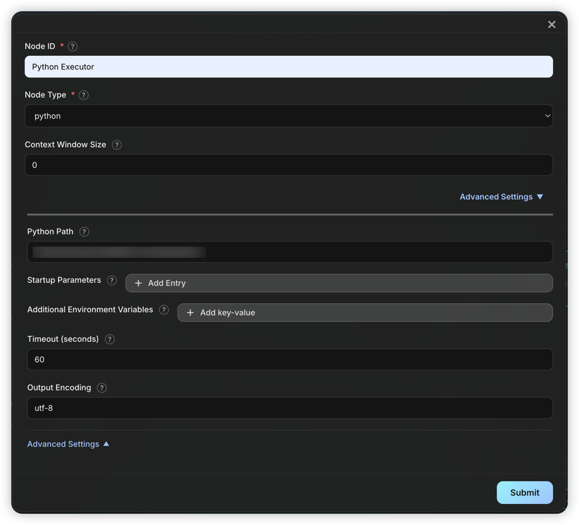

**Cơ chế thực thi:**
- Nút tự động trích xuất nội dung ```python ...``` từ đầu vào; nếu không trích xuất được, toàn bộ đầu vào sẽ được coi là tập lệnh.
- Đầu ra stdout của tập lệnh được chuyển thành một Message cho các nút phía sau.
- Bạn có thể chỉ định biến môi trường, tham số khởi động và thời gian chờ tối đa (timeout). Thường không cần đổi Python Path, trừ khi cần một phiên bản Python hoặc venv cụ thể.
- Mọi nút Python dùng chung thư mục `code_workspace/`, và tệp người dùng tải lên được lưu trong các thư mục con để tập lệnh có thể truy cập.

---

<a id="passthrough-node"></a>
## Nút Passthrough

Nút Passthrough không xử lý gì cả mà chỉ chuyển tiếp message xuống phía sau. **Theo mặc định, chỉ message cuối cùng được chuyển tiếp**; bạn có thể đổi cấu hình (`Only Last Message`) để chuyển tiếp tất cả message.

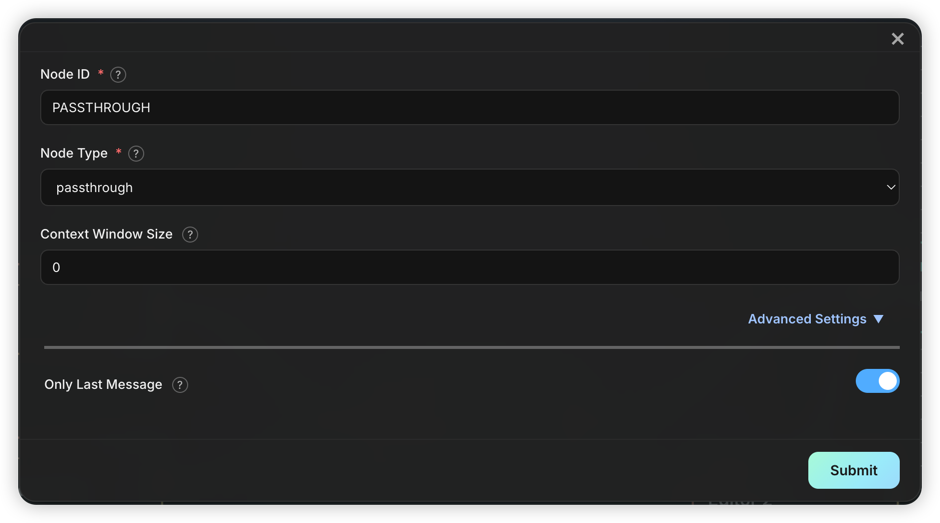

**Công dụng chính:**

1. **Làm nút đầu vào để giữ lại ngữ cảnh ban đầu**: kết hợp với `Keep Message Input` trên liên kết để đảm bảo nhiệm vụ gốc luôn được giữ lại (ví dụ `workspace/workflows/AgentDev_v1.yaml`)
2. **Lọc đầu ra thừa trong vòng lặp**: chỉ chuyển tiếp kết quả cuối cùng để kiểm soát đầu ra của vòng lặp và tránh ngữ cảnh phình to
3. **Đơn giản hóa cấu trúc đồ thị**: làm nút giữ chỗ về mặt logic để tổ chức và dễ đọc hơn (ví dụ `workspace/workflows/AgentDev_v1.yaml`)

---

<a id="literal-node"></a>
## Nút Literal

Nút Literal xuất ra một đoạn văn bản cố định và bỏ qua mọi đầu vào. Bạn có thể đặt vai trò (Role) của Message là `user` hoặc `assistant`.

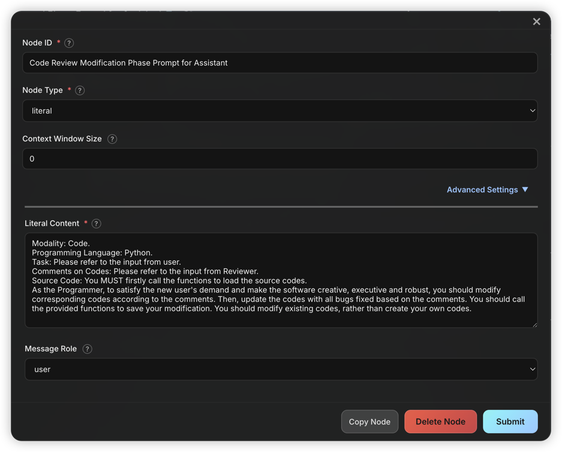

**Công dụng điển hình:**
- Chèn chỉ dẫn hoặc ngữ cảnh cố định (ví dụ `workspace/workflows/AgentDev_v1.yaml`)
- Kiểm thử các nút phía sau (ví dụ `workspace/workflows/demo_dynamic.yaml`)
- Phản hồi cố định trong các nhánh điều kiện

---

<a id="loop-counter-node"></a>
## Nút Loop Counter

Nút Loop Counter (bộ đếm vòng lặp) giới hạn số lần thực thi của vòng lặp. Nút đếm số lần được kích hoạt và chỉ xuất ra kết quả khi đạt giới hạn, qua đó kết thúc vòng lặp.

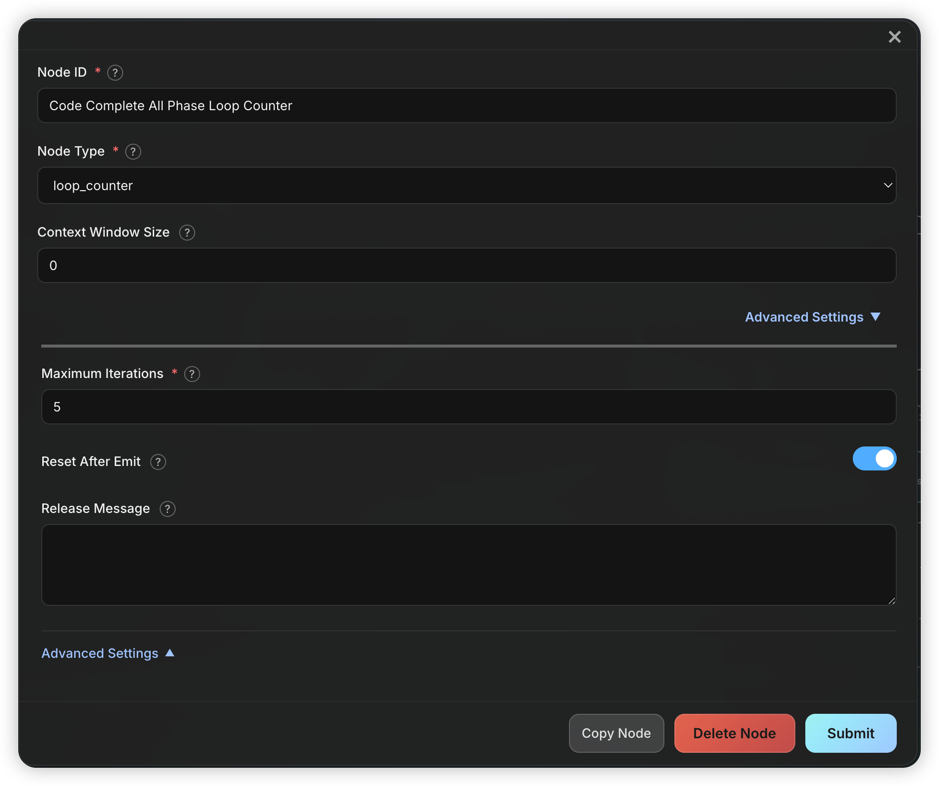

**Cách hoạt động:**
1. Mỗi lần được kích hoạt, bộ đếm tăng thêm 1
2. Bộ đếm < `max_iterations`: **không có đầu ra**, liên kết không được kích hoạt
3. Bộ đếm = `max_iterations`: có đầu ra, liên kết được kích hoạt

> **Quan trọng**: Vì nút không có đầu ra trước khi đạt giới hạn, liên kết của Loop Counter phải nối cả tới các nút bên trong vòng lặp (để duy trì vòng lặp, nhưng không có tác dụng gì) lẫn các nút bên ngoài (để thoát ra khi đạt giới hạn).

Xem: `workspace/workflows/AgentDev_v1.yaml`

---

<a id="subgraph-node"></a>
## Nút Đồ thị con (Subgraph)

Nút Đồ thị con cho phép nhúng một đồ thị quy trình khác vào quy trình hiện tại để tái sử dụng và thiết kế theo mô-đun. Đồ thị con có thể lấy từ tệp YAML bên ngoài hoặc được định nghĩa trực tiếp (inline).

### Cấu hình chính

| Trường                  | Kiểu   | Mô tả                                              |
|------------------------|--------|---------------------------------------------------------|
| `Subgraph Source Type` | string | Loại nguồn: `file` (tệp bên ngoài) hoặc `config` (định nghĩa trực tiếp)     |
| `Config`               | object | Phụ thuộc vào `Subgraph Source Type` (xem bên dưới)           |

**Cấu hình cho loại file:**

| Trường                | Kiểu   | Bắt buộc | Mô tả                                 |
|----------------------|--------|----------|---------------------------------------------|
| `Subgraph File Path` | string | Có      | Đường dẫn tệp đồ thị con (tương đối so với `workspace/workflows/` hoặc tuyệt đối) |

**Cấu hình cho loại config** (định nghĩa trực tiếp):

Các mục cấu hình giống hệt một đồ thị thông thường.

### Công dụng điển hình

- **Tái sử dụng quy trình**: nhiều quy trình dùng chung một quy trình con (ví dụ mô-đun "trau chuốt bài viết")
- **Thiết kế theo mô-đun**: chia các luồng phức tạp thành những đơn vị dễ quản lý
- **Cộng tác nhóm**: các nhóm khác nhau bảo trì các mô-đun đồ thị con khác nhau

> **Lưu ý**:
> - Đồ thị con kế thừa các định nghĩa biến `vars` của đồ thị cha
> - Đồ thị con thực thi như một đơn vị độc lập, có không gian tên nút riêng
> - Các nút `start` và `end` quyết định luồng dữ liệu vào/ra:
>   - `start`: chỉ cần khi đồ thị con là một vòng lặp.
>   - `end`: danh sách các nút thoát. Hệ thống kiểm tra lần lượt theo thứ tự và trả về đầu ra của nút đầu tiên có kết quả làm kết quả của đồ thị con. Nếu không có nút nào có kết quả, hoặc không thiết lập, các nút không có nút kế tiếp sẽ được dùng làm nút thoát.

Xem: `workspace/workflows/MACNet_optimize_sub.yaml`, `workspace/workflows/MACNet_Node_sub.yaml`, `workspace/workflows/MACNet_v1.yaml`.

---

<a id="edge-configuration"></a>
# Cấu hình liên kết

Liên kết nối các nút với nhau, điều khiển luồng thực thi và dữ liệu. Mỗi nút có thể có nhiều đầu ra, và tất cả đầu ra đều được mọi liên kết xử lý.

## Cấu hình chính

Trong phần cấu hình liên kết, nhấn **Cài đặt nâng cao** để mở rộng các tùy chọn:

| Trường                   | Mặc định   | Mô tả                                                    |
|-------------------------|-----------|----------------------------------------------------------------|
| `Edge Condition`        | -         | Liên kết có hoạt động hay không; mặc định luôn bật               |
| `Can Trigger Successor` | `true`    | Có kích hoạt nút đích hay không. Nếu `false` thì không kích hoạt|
| `Pass Data to Target`   | `true`    | Có truyền dữ liệu cho nút đích hay không. Nếu `false` thì không truyền   |
| `Keep Message Input`    | `false`   | Có đánh dấu message là **được giữ lại** (không bị tự động xóa) hay không        |
| `Clear Context`         | `false`   | Có xóa toàn bộ lịch sử không được giữ lại của nút đích hay không       |
| `Clear Kept Context`    | `false`   | Có xóa toàn bộ lịch sử được giữ lại của nút đích hay không           |
| `Payload Processor`     | -         | Bộ xử lý nội dung message                                  |
| `Dynamic Expansion`     | -         | Cấu hình thực thi động, xem [Chế độ thực thi động](#dynamic-execution-mode) |

<a id="edge-condition"></a>
## Điều kiện liên kết

Điều kiện quyết định liên kết có được bật hay không. Nếu đúng, liên kết được bật (dữ liệu có thể đi qua, có thể kích hoạt nút đích); ngược lại, liên kết bị tắt (không ảnh hưởng gì đến nút phía sau).

### Điều kiện theo từ khóa (thường dùng)
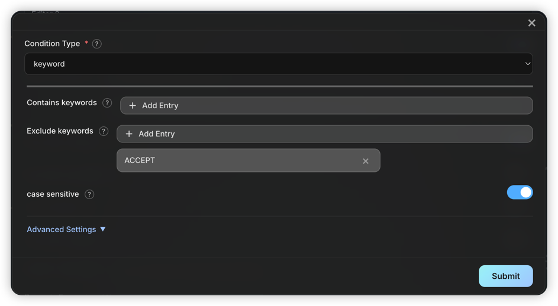

### Điều kiện theo hàm
Một số hàm có sẵn: `true` (mặc định, luôn bật), `code_pass` (mã chạy thành công), `code_fail` (mã chạy thất bại), `always_false` (luôn tắt, dùng để kiểm thử)

Bạn có thể thêm hàm tùy chỉnh trong `workspace/functions/edge` rồi khởi động lại backend để sử dụng.

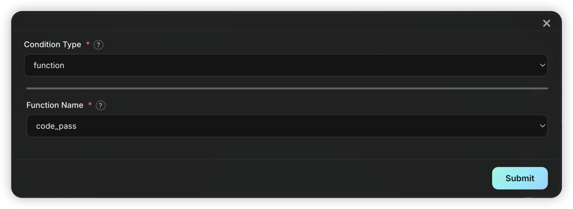

<a id="payload-processor"></a>
## Bộ xử lý nội dung (Payload Processor)

Payload Processor biến đổi hoặc xử lý nội dung message trước khi đi qua liên kết. Hữu ích khi cần trích xuất thông tin, chuyển đổi định dạng hoặc áp dụng logic tùy chỉnh.

### Các loại bộ xử lý có sẵn

#### 1. regex_extract

Dùng biểu thức chính quy (regex) của Python để trích xuất nội dung từ message:

| Mục cấu hình         | Mô tả                  |
|---------------------|-----------------------------|
| `Regex Pattern`     | Mẫu regex (bắt buộc)     |
| `Capture Group`     | Tên hoặc chỉ số nhóm bắt  |
| `Case Sensitive`    | Phân biệt chữ hoa/thường (mặc định true)|
| `Multiline Flag`    | Bật re.MULTILINE (mặc định false)  |
| `Dotall Flag`       | Bật re.DOTALL (mặc định false)     |
| `Return Multiple Matches` | Trả về tất cả kết quả khớp (mặc định chỉ trả về kết quả đầu tiên) |
| `Output Template`   | Mẫu đầu ra, dùng `{match}`|
| `No Match Behavior` | `pass`, `default`, `drop`    |
| `Default Value`     | Dùng khi `No Match Behavior=default` |

**Ví dụ**: trích xuất mã (xem `workspace/workflows/demo_edge_transform.yaml`)

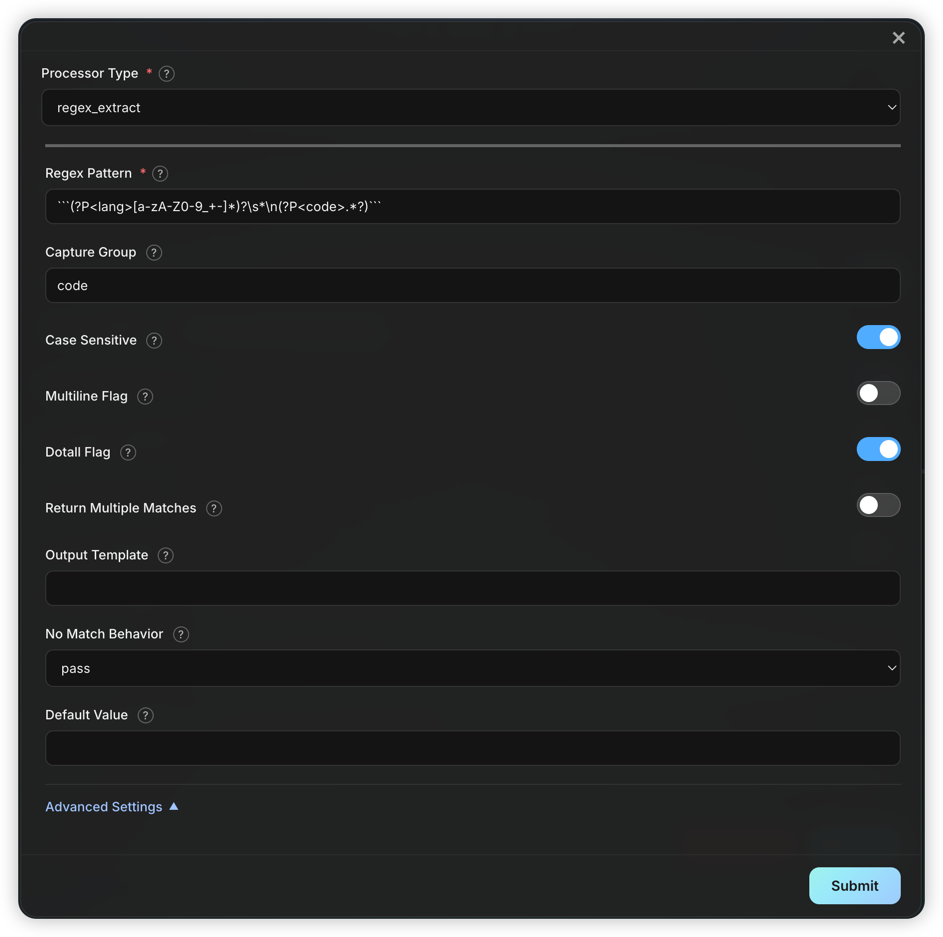

#### 2. function

Gọi các hàm Python trong `workspace/functions/edge_processor/` để xử lý tùy chỉnh:

| Mục cấu hình | Mô tả |
|-------------|-------------|
| `name`      | Tên hàm (bắt buộc) |

**Các hàm có sẵn:**
- `uppercase_payload`: chuyển message thành chữ in hoa
- `code_save_and_run`: lưu mã vào không gian làm việc và chạy `main.py` (xem `workspace/workflows/MACNet_optimize_sub.yaml`)

### Hàm xử lý tùy chỉnh

Tạo một tệp Python trong `workspace/functions/edge_processor/` và định nghĩa một hàm:

```python
from typing import Dict, Any

def my_processor(data: str, _context: Dict[str, Any]) -> str:
    """Function description (shown in config UI)"""
    # data is the message text
    # _context contains execution context
    return processed_data
```

Trong đó, `data` là nội dung văn bản của message, `_context` chứa ngữ cảnh thực thi, còn docstring của hàm sẽ được hiển thị trên giao diện cấu hình.

Khởi động lại backend để dùng hàm mới.

---

<a id="graph-execution-logic"></a>
# Logic thực thi của đồ thị

<a id="dag-execution"></a>
## Thực thi DAG

Với đồ thị quy trình không có chu trình, bộ máy thực thi dùng phương pháp sắp xếp tô-pô tiêu chuẩn:

1. Xây dựng quan hệ nút trước/nút sau
2. Tính bậc vào (in-degree) của từng nút
3. Các nút có bậc vào bằng 0 được thực thi trước
4. Các nút cùng tầng có thể thực thi song song

<a id="loop-graph-execution"></a>
## Thực thi đồ thị có vòng lặp

Với đồ thị có vòng lặp, bộ máy thực thi dùng **thuật toán thành phần liên thông mạnh của Tarjan** để phát hiện vòng lặp và thực thi đệ quy cho các vòng lặp lồng nhau.

### Phát hiện vòng lặp và dựng siêu nút

Hệ thống áp dụng thuật toán Tarjan lên toàn bộ đồ thị, xác định tất cả các thành phần liên thông mạnh (SCC) chỉ trong một lần duyệt (O(|N|+|E|)).

- **SCC**: tập nút lớn nhất mà mọi cặp nút trong đó đều có thể đi tới nhau
- **Vòng lặp**: SCC có nhiều hơn một nút; SCC chỉ có một nút và không có liên kết tự vòng là nút bình thường

Sau khi phát hiện, mỗi vòng lặp nhiều nút được trừu tượng hóa thành một **siêu nút (Super Node)**, từ đó dựng đồ thị phụ thuộc giữa các siêu nút. Vì các vòng lặp đã được đóng gói, đồ thị siêu nút luôn là một DAG, nên có thể sắp xếp tô-pô.

### Thực thi vòng lặp đệ quy

Với siêu nút là vòng lặp, bộ máy thực thi dùng chiến lược đệ quy sau:

#### Bước 1: Xác định nút khởi đầu

Phân tích biên của vòng lặp để xác định nút đầu vào **được kích hoạt duy nhất** làm nút khởi đầu (Initial Node):
- Phải được một nút trước nằm ngoài vòng lặp kích hoạt thông qua một liên kết thỏa điều kiện
- Nếu không có nút nào được kích hoạt, bỏ qua việc thực thi vòng lặp
- Nếu có nhiều nút được kích hoạt, báo lỗi cấu hình

#### Bước 2: Dựng đồ thị con trong phạm vi vòng lặp

Bên trong vòng lặp, dựng một đồ thị con trong đó **loại bỏ về mặt logic mọi liên kết đi vào nút khởi đầu**. Việc này phá vỡ biên của vòng lặp ngoài để phát hiện các vòng lặp lồng bên trong.

#### Bước 3: Phát hiện vòng lặp lồng nhau

Áp dụng thuật toán Tarjan lên đồ thị con để phát hiện vòng lặp lồng nhau. Vì các liên kết đi vào nút khởi đầu đã bị loại bỏ, chỉ những vòng lặp thật sự nằm bên trong mới được phát hiện.

#### Bước 4: Sắp xếp tô-pô bên trong

- Nếu có vòng lặp lồng nhau: trừu tượng hóa từng vòng lặp thành siêu nút, dựng đồ thị phụ thuộc rồi sắp xếp
- Nếu không có: sắp xếp tô-pô trực tiếp đồ thị con

#### Bước 5: Thực thi theo tầng

Thực thi lần lượt từng tầng:
- **Nút thường**: kiểm tra trạng thái kích hoạt rồi thực thi; nút khởi đầu bắt buộc được thực thi ở vòng đầu tiên
- **Siêu nút vòng lặp bên trong**: **áp dụng đệ quy các bước trên**

#### Bước 6: Kiểm tra điều kiện thoát

Sau mỗi vòng, kiểm tra các điều kiện thoát:
- **Liên kết thoát được kích hoạt**: nếu có nút nào kích hoạt liên kết đi ra ngoài vòng lặp thì thoát
- **Số vòng lặp tối đa**: nếu đạt `max_iterations` (mặc định 100) thì buộc thoát
- **Nút khởi đầu không được kích hoạt lại**: nếu không được các nút trước bên trong vòng lặp kích hoạt lại, vòng lặp tự nhiên kết thúc

Nếu không điều kiện nào thỏa mãn, lặp lại từ Bước 2.

> **Khả năng đệ quy**: Cơ chế này tạo thành một cấu trúc đệ quy hoàn chỉnh, cho phép hệ thống xử lý các vòng lặp lồng nhau ở độ sâu bất kỳ.

### Lưu đồ thực thi

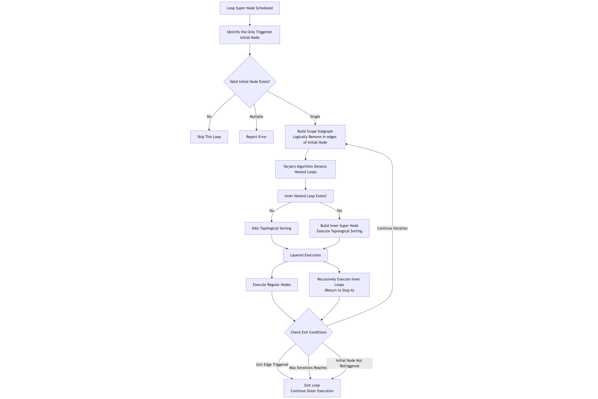

---

<a id="workspace-structure"></a>
# Cấu trúc không gian làm việc

AgentDev dùng cấu trúc không gian làm việc phân tầng để quản lý tệp:

## Cấu trúc thư mục

| Đường dẫn                                             | Mục đích                        |
|--------------------------------------------------|--------------------------------|
| `storage/warehouse/`                                     | Thư mục gốc chứa mọi phiên|
| `storage/warehouse/<session>/`                   | Dữ liệu chạy của một phiên     |
| `storage/warehouse/<session>/code_workspace/`            | Thư mục thực thi mã của nút Python |
| `storage/warehouse/<session>/code_workspace/attachments/`| Tệp người dùng tải lên            |
| `storage/warehouse/<session>/execution_logs.json`        | Nhật ký thực thi (sau khi chạy)     |
| `storage/warehouse/<session>/node_outputs.yaml`          | Bản ghi đầu ra của các nút (sau khi chạy)|
| `storage/warehouse/<session>/token_usage_<session>.json` | Thống kê lượng token sử dụng (sau khi chạy)  |
| `storage/warehouse/<session>/workflow_summary.yaml`      | Tóm tắt quy trình (sau khi chạy)   |

---

<a id="dynamic-execution-mode"></a>
# Chế độ thực thi động

Chế độ thực thi động cho phép định nghĩa xử lý song song ở cấp liên kết, hỗ trợ hai chế độ **Map** (phân tán) và **Tree** (gộp dần).

Xem ví dụ tại `workspace/workflows/demo_dynamic.yaml`, `workspace/workflows/MACNet_Node_sub.yaml`.

## So sánh các chế độ

| Chế độ   | Mô tả         | Đầu ra             | Trường hợp dùng           |
|--------|---------------------|--------------------|--------------------|
| **Map**  | Phân tán, song song   | `List[Message]`    | Xử lý hàng loạt, song song    |
| **Tree** | Gộp dần, hợp nhất    | Một `Message` duy nhất   | Tóm tắt      |

## Cấu hình ví dụ

Cấu hình động được định nghĩa trên **liên kết**, cho biết các message đi qua liên kết này cần được xử lý động:

### Chế độ Map
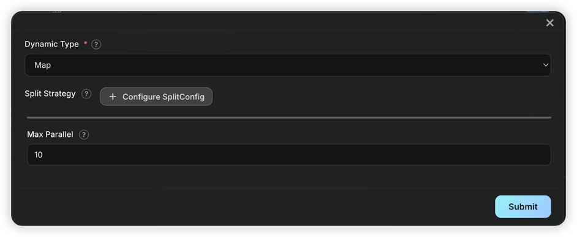

### Chế độ Tree
Dùng cho tóm tắt:
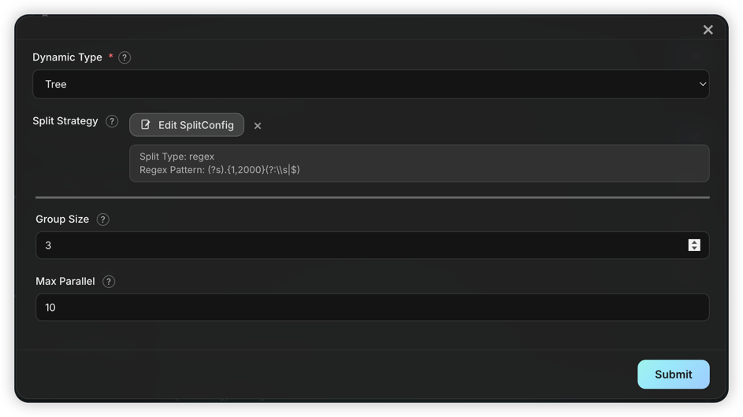
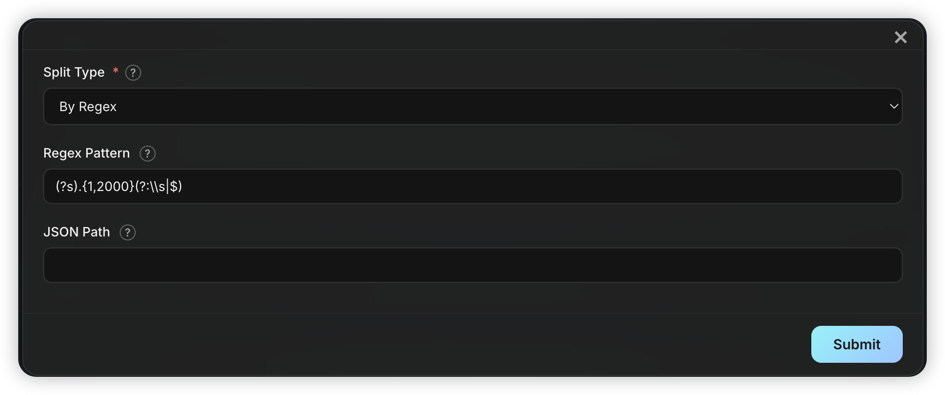
`(?s).{1,2000}(?:\s|$)` chia đầu vào thành các đoạn dài khoảng 2000 ký tự.
Xem `workspace/workflows/demo_dynamic_tree.yaml`.

## Chiến lược chia nhỏ

| Loại        | Mô tả                                 |
|-------------|---------------------------------------------|
| `message`   | Mỗi message là một đơn vị (mặc định)            |
| `regex`     | Chia văn bản bằng regex                      |
| `json_path` | Trích xuất các phần tử mảng từ đầu ra JSON     |

## Kết hợp liên kết tĩnh và liên kết động

Khi nút đích có cả liên kết đi vào dạng động và dạng tĩnh:
- **Message từ liên kết động**: được chia nhỏ và thực thi nhiều lần
- **Message từ liên kết tĩnh**: được **sao chép** cho từng phiên bản thực thi động
