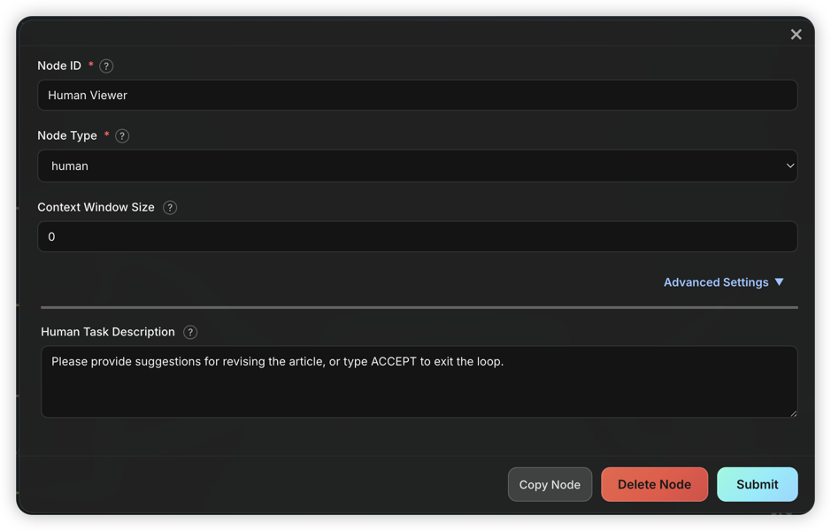

# Hướng dẫn sử dụng AgentDev

AgentDev giúp bạn dựng một "công ty AI": mỗi nhân viên là một **agent**, các agent được sắp xếp thành một **quy trình**, và bạn giao việc cho cả đội ngay trong khung trò chuyện. Hướng dẫn này đi theo đúng thứ tự bạn sẽ làm trong ứng dụng.

- [1. Khái niệm cơ bản](#concepts)
- [2. Kết nối tài khoản](#connections)
- [3. Thư viện skill](#skill-library)
- [4. Xây dựng quy trình](#build-workflow)
  - [Tạo nút](#2-create-nodes)
  - [Liên kết các nút](#what-is-an-edge)
  - [Trưởng nhóm và thành viên](#team-lead)
  - [Gắn skill cho agent](#attach-skills)
  - [Ví dụ: quy trình viết bài có liên kết](#example-linked-workflow)
- [5. Mẫu "Công ty phần mềm"](#software-company)
- [6. Chạy quy trình](#run-page)
- [7. Phòng thí nghiệm](#lab)
- [Tham khảo: các loại nút](#node-types-explained)
- [Tham khảo: cấu hình liên kết](#edge-configuration)
- [Tham khảo: logic thực thi](#graph-execution-logic)
- [Tham khảo: chế độ thực thi động](#dynamic-execution-mode)
- [Tham khảo: cấu trúc thư mục](#workspace-structure)

---

<a id="concepts"></a>
## 1. Khái niệm cơ bản

| Thuật ngữ | Nghĩa |
|-----------|-------|
| **Quy trình** (workflow) | Một tệp YAML mô tả đội agent và cách họ phối hợp. Danh sách quy trình nằm ở mục **Quy trình** trên thanh điều hướng ở trên cùng. |
| **Nút** (node) | Một bước trong quy trình. Loại nút hay dùng nhất là **Agent**; ngoài ra có Người dùng, Python, Văn bản cố định, Chuyển tiếp, Bộ đếm vòng lặp, Quy trình con. |
| **Liên kết** (edge) | Mũi tên nối hai nút: chuyển kết quả của nút nguồn sang nút đích và có thể kích hoạt nút đích chạy. |
| **Agent** | Một nút gọi model AI (Claude, Codex, Gemini) với vai trò, prompt, công cụ và skill riêng. |
| **Trưởng nhóm** | Agent duy nhất trò chuyện với bạn (ví dụ CTO, PM, CEO). Trưởng nhóm tự quyết định giao việc cho thành viên nào, khi nào. |
| **Thành viên** | Các agent mà trưởng nhóm được giao việc. Thường là các nút agent **không có liên kết nào**. |
| **Skill** | Một tệp hướng dẫn (SKILL.md) dạy agent cách làm một loại việc, ví dụ "lập kế hoạch", "review code". Skill nằm trong thư viện dùng chung. |
| **Kết nối** | Tài khoản AI bạn đã đăng nhập (Claude, Codex/ChatGPT, Gemini). Mỗi agent chạy bằng một kết nối. |
| **Phiên** | Một lần làm việc trên trang **Chạy**: gồm lịch sử trò chuyện, tệp đính kèm và (nếu có) thư mục dự án. |

---

<a id="connections"></a>
## 2. Kết nối tài khoản

Agent cần một tài khoản AI để chạy. Mở **Cài đặt → Kết nối** (nút bánh răng ở góc phải thanh điều hướng ở trên cùng).

1. Ở mục **Nhà cung cấp**, chọn thẻ của nhà cung cấp rồi bấm **Kết nối**.
2. Chọn cách đăng nhập và làm theo hướng dẫn trong hộp thoại:
   - **Anthropic Claude**: **Đăng nhập bằng tài khoản**, dùng công cụ dòng lệnh Claude CLI trên máy. Nếu máy đã đăng nhập sẵn, chỉ cần bấm **Kết nối**; nếu chưa, bấm **Tiếp tục với tài khoản Claude**, mở liên kết đăng nhập, đăng nhập rồi dán mã xác nhận vào ô **Dán mã vào đây** và bấm **Xác nhận**.
   - **OpenAI (Codex)**: **Đăng nhập bằng ChatGPT** (mở trang đăng nhập OpenAI, dùng gói Plus/Pro/Team) hoặc **Dùng mã thiết bị** (nhận một mã rồi nhập vào trình duyệt, tiện khi trình duyệt không nằm cùng máy với máy chủ).
   - **Google Gemini**: **Đăng nhập với Google**. Máy chủ cần đặt `GOOGLE_OAUTH_CLIENT_ID` và `GOOGLE_OAUTH_CLIENT_SECRET` trong tệp `.env`.
3. Kết nối mới hiện ở mục **Kết nối của bạn**. Bấm vào một kết nối để xem tài khoản, **Mức sử dụng** (theo phiên 5 giờ, theo tuần...) và **Model khả dụng**.

Mẹo:

- **Đặt làm mặc định**: mọi nút agent chưa chọn kết nối riêng sẽ chạy bằng kết nối mặc định.
- **Kiểm tra**: kiểm tra nhanh kết nối còn dùng được không. Khi chạy quy trình báo lỗi xác thực, hãy bấm Kiểm tra trước.
- Thông tin đăng nhập chỉ nằm trên máy chủ của bạn, không bao giờ được ghi vào tệp quy trình.
- Nếu Claude CLI hoặc Codex CLI chưa được cài, hộp thoại sẽ nhắc bạn cài trước.

**Tự chuyển tài khoản khi hết hạn mức.** Khi tài khoản một agent đang dùng báo hết lượt (ví dụ Claude hết hạn mức 5 giờ), AgentDev tự chuyển agent đó sang một tài khoản khác đã đăng nhập: ưu tiên nhà cung cấp khác (Claude → Codex, Codex → Claude, rồi Gemini). Model được đổi sang model mặc định của tài khoản mới. Khung trò chuyện và một thông báo nổi cho bạn biết đã chuyển từ tài khoản nào sang tài khoản nào. Các agent chạy sau trong cùng lượt dùng luôn tài khoản mới. Nếu không còn tài khoản nào, bạn sẽ nhận thông báo lỗi và cần đăng nhập thêm ở trang **Kết nối**. Vì vậy nên đăng nhập cả Claude và Codex.

**Cài đặt chung.** Trong **Cài đặt → Cài đặt chung** bạn đổi ngôn ngữ giao diện (Tiếng Việt, English, 中文) và giao diện sáng/tối. Cùng nội dung này cũng có trong hộp thoại Cài đặt mở nhanh từ thanh điều hướng.

**Chọn nhà cung cấp cho agent.** Nếu một agent được đặt dùng model của một nhà cung cấp (ví dụ OpenAI) mà bạn đã đăng nhập, AgentDev ưu tiên kết nối cùng nhà cung cấp đó; nếu chưa có, agent chạy bằng kết nối mặc định và giao diện hiện thông báo cho bạn biết.

---

<a id="skill-library"></a>
## 3. Thư viện skill

Mở **Cài đặt → Skill**. Đây là kho skill dùng chung: thêm một lần, dùng cho mọi agent. Sửa một skill thì mọi agent đang dùng nó đều được cập nhật.

**Thêm skill**

1. Bấm **Thêm skill**.
2. Dán nội dung SKILL.md vào ô **Nội dung** (có hoặc không có phần frontmatter `---`), hoặc bấm **Tải tệp .md lên** / kéo thả tệp `.md` vào ô (tối đa 256 KB).
3. Nếu nội dung không có frontmatter, điền **Tên** (chữ thường, số, dấu `-`) và **Mô tả: dùng khi nào**. Mô tả rất quan trọng: agent đọc nó để biết lúc nào cần nạp skill.
4. Bấm **Lưu skill**. Nếu trùng tên, ứng dụng hỏi bạn có muốn **Ghi đè** không.

**Nhập skill từ Claude**

Nếu bạn đã có skill trong `~/.claude/skills`, bấm **Nhập từ Claude**. Hộp thoại **Nhập skill từ thư mục** liệt kê các skill tìm thấy; chọn skill cần nhập (hoặc **Chọn tất cả**), bật **Ghi đè skill đã có** nếu muốn thay bản cũ, rồi bấm **Nhập N skill**. Bạn có thể đổi **Thư mục nguồn** và bấm **Tải lại**.

Mỗi thẻ skill có nút **Sửa** và **Xóa**. Skill có lỗi định dạng được đánh dấu **Lỗi định dạng**.

---

<a id="build-workflow"></a>
## 4. Xây dựng quy trình

Mở **Quy trình** trên thanh điều hướng ở trên cùng. Bên trái là danh sách quy trình; bấm **Tạo quy trình** để tạo mới, hoặc chọn một quy trình có sẵn để sửa.

Trình sửa quy trình có hai thẻ:

- **Sơ đồ quy trình**: kéo thả các nút và liên kết.
- **Mã YAML**: xem và sửa trực tiếp tệp YAML.

Thanh công cụ phía trên sơ đồ gồm:

- **Tạo nút**: mở biểu mẫu tạo nút (hoặc nhấp chuột phải vào vùng trống của sơ đồ để tạo nút tại chỗ).
- **Cài đặt quy trình**: mô tả, chỉ dẫn ban đầu, mức nhật ký, bộ nhớ, nút bắt đầu và kết thúc.
- **Chạy**: mở trang Chạy với quy trình này.
- Menu (rê chuột lên biểu tượng cuối thanh công cụ): **Đổi tên quy trình**, **Sao chép quy trình**, **Quản lý biến**, **Quản lý bộ nhớ**, **Tạo liên kết**.

Trong **Cài đặt**, bật **Bật chú thích trợ giúp** để xem giải thích khi rê chuột lên nút, liên kết và các nút bấm.

**Trợ lý quy trình.** Trong trình sửa có khung **Trợ lý quy trình**: mô tả bằng lời điều bạn muốn đổi (thêm thành viên, sửa prompt, nối liên kết...) và trợ lý đề xuất thay đổi cho quy trình để bạn xem rồi áp dụng. Các cuộc trò chuyện được lưu thành phiên, và bạn chọn được model cho trợ lý. Trợ lý chạy bằng tài khoản đã kết nối của bạn nên có tốn token.

<a id="2-create-nodes"></a>
### Tạo nút

Bấm **Tạo nút**, chọn **Loại nút** rồi điền biểu mẫu. Với nút **Agent**, các trường quan trọng là:

| Trường | Ý nghĩa |
|--------|---------|
| **ID nút** | Tên duy nhất của nút, ví dụ `Backend Developer`. Trưởng nhóm gọi thành viên bằng ID này. |
| **Mô tả nút** | Một câu tóm tắt nút làm gì. Trưởng nhóm đọc mô tả này để chọn đúng người giao việc, nên hãy viết rõ ràng. |
| **Nhân vật** | Hình đại diện của nút trên sơ đồ, trang Chạy và Văn phòng. |
| **Kết nối tài khoản** | Tài khoản dùng để gọi model. Để trống sẽ dùng kết nối mặc định. |
| **Model** | Chọn từ danh sách model của tài khoản đã kết nối, hoặc chọn **Nhập tên model khác...** |
| **Prompt hệ thống (vai trò)** | Vai trò, nhiệm vụ và quy tắc làm việc của agent. |
| **Skill của agent** | Chọn skill từ thư viện (xem [Gắn skill cho agent](#attach-skills)). |
| **Trưởng nhóm** | Biến agent thành trưởng nhóm (xem [Trưởng nhóm và thành viên](#team-lead)). |
| **Cấu hình công cụ** | Các công cụ agent được dùng: đọc/ghi tệp, chạy mã, tìm kiếm web, máy chủ MCP... |
| **Số tin nhắn ngữ cảnh** | Số tin nhắn cũ agent được nhớ giữa các lần chạy. `-1` là không giới hạn. |

Một số trường ít dùng nằm trong **Cài đặt nâng cao** ở cuối biểu mẫu. Bấm **Lưu** để lưu nút; **Sao chép nút** để nhân bản (bản sao cần một ID mới); **Xóa nút** để xóa nút cùng các liên kết của nó.

<a id="what-is-an-edge"></a>
### Liên kết các nút

**Liên kết** nối hai nút với nhau và có hai tác dụng:

1. **Truyền dữ liệu**: kết quả của nút nguồn trở thành đầu vào của nút đích.
2. **Điều khiển thứ tự chạy**: khi nút nguồn chạy xong, liên kết có thể kích hoạt nút đích chạy.

Cách tạo: kéo từ chấm nối ở cạnh một nút sang nút khác, hoặc dùng **Tạo liên kết** trong menu. Bấm vào một liên kết để sửa hoặc **Xóa liên kết**.

**Nút bắt đầu** là điểm khởi đầu của quy trình: mọi nút nối với nút bắt đầu sẽ nhận nhiệm vụ của bạn và chạy song song ngay khi quy trình khởi động. Nút bắt đầu phải giữ ít nhất một liên kết.

Chi tiết các tùy chọn của liên kết (điều kiện, chỉ truyền dữ liệu mà không kích hoạt, giữ tin nhắn...) xem ở [Tham khảo: cấu hình liên kết](#edge-configuration).

<a id="team-lead"></a>
### Trưởng nhóm và thành viên

Thay vì nối cứng thứ tự các bước bằng liên kết, bạn có thể dựng một **đội** có trưởng nhóm. Trưởng nhóm là agent duy nhất trò chuyện với bạn; trong lúc làm việc, trưởng nhóm tự quyết định giao việc cho thành viên nào, bao nhiêu lần và theo thứ tự nào, rồi tổng hợp kết quả báo lại cho bạn.

Cách dựng:

1. Tạo nút agent cho trưởng nhóm (ví dụ `CTO`) và nối nút bắt đầu tới nút này.
2. Tạo các nút agent cho thành viên. **Không nối liên kết nào** tới các nút này: trưởng nhóm sẽ gọi họ khi cần. Viết **Mô tả nút** thật rõ để trưởng nhóm biết ai làm gì.
3. Mở biểu mẫu của trưởng nhóm, bấm cấu hình mục **Trưởng nhóm** và điền:

| Trường | Ý nghĩa |
|--------|---------|
| **Làm trưởng nhóm** | Bật để agent này làm trưởng nhóm. |
| **Thành viên** | ID các nút agent được giao việc. Để trống = mọi nút agent không có liên kết nào. |
| **Trình kế hoạch trước khi làm** | Với việc mới, trưởng nhóm trình kế hoạch (công nghệ, kiến trúc, đầu việc) và chờ bạn duyệt, trừ khi bạn đã bảo cứ làm luôn. |
| **Số lần giao việc tối đa mỗi yêu cầu** | (Cài đặt nâng cao) Giới hạn số lần giao việc trong một lượt, để kiểm soát lượng token. |
| **Số vòng sửa/duyệt tối đa** | (Cài đặt nâng cao) Số lần một việc chưa đạt được gửi lại để sửa trước khi trưởng nhóm báo cáo cho bạn. |

Khi chạy, trưởng nhóm có thể **hỏi lại bạn** nếu yêu cầu chưa rõ. Câu hỏi hiện trong khung trò chuyện; bạn chỉ cần trả lời như bình thường. Việc giao và nhận việc hiện thành các dòng như "CTO giao việc cho Backend Developer" và "Backend Developer đã báo cáo CTO".

<a id="attach-skills"></a>
### Gắn skill cho agent

Trong biểu mẫu nút agent, mục **Skill của agent** liệt kê toàn bộ thư viện skill. Đánh dấu các skill trang bị cho agent này; số skill đã chọn hiện ở góc trên. Bấm **Mở thư viện skill** để thêm hoặc sửa skill trong thẻ mới. Agent chỉ nạp nội dung skill khi việc đang làm khớp với phần mô tả "dùng khi nào" của skill.

<a id="example-linked-workflow"></a>
### Ví dụ: quy trình viết bài có liên kết

Quy trình mẫu `demo_loop_counter` minh họa cách nối các nút bằng liên kết:

1. Tạo ba nút agent **Poet** (viết thơ), **Article Writer** (viết bài) và **Editor 1** (gộp bài và thơ).
2. Nối nút bắt đầu tới Poet và Article Writer: hai nút này chạy song song.
3. Nối `Poet → Editor 1` và `Article Writer → Editor 1`: Editor 1 chạy sau khi nhận đủ hai kết quả.


Muốn thêm vòng duyệt, tạo nút **Người dùng** (human) hỏi bạn "Góp ý cho bài viết, hoặc nhập ACCEPT để kết thúc", rồi dùng **liên kết có điều kiện**: nếu bạn nhập `ACCEPT` thì kết thúc, ngược lại chuyển sang **Editor 2** để sửa tiếp. Xem [Điều kiện liên kết](#edge-condition).


---

<a id="software-company"></a>
## 5. Mẫu "Công ty phần mềm"

Quy trình `software_company` là một công ty phần mềm dựng sẵn (web, web app, desktop) gồm **CTO** làm trưởng nhóm và 11 thành viên:

| Thành viên | Việc chính |
|-----------|------------|
| Project Manager | Yêu cầu, user story, tiêu chí nghiệm thu, chia việc và lịch |
| Solution Architect | Phân tích hệ thống, kiến trúc, ranh giới module, API, lỗi ở mức thiết kế |
| Data Engineer | Lược đồ CSDL, migration, truy vấn, toàn vẹn và hiệu năng dữ liệu |
| Backend Lead | Dẫn dắt kỹ thuật backend, thiết kế API, review code backend |
| Backend Developer | Làm tính năng và API backend kèm test |
| Frontend Developer | Trang, component, state, tích hợp API, responsive và accessibility |
| UI UX Designer | Luồng UX, bố cục, hệ thống thiết kế, đặc tả giao diện |
| Bug Fixer | Tái hiện, tìm nguyên nhân gốc và sửa lỗi, kèm test chống tái phát |
| QA Tester | Kiểm thử theo tiêu chí nghiệm thu, báo đạt/không đạt kèm bằng chứng |
| Acceptance Reviewer | Nghiệm thu cuối: kết quả có đúng yêu cầu và đạt chất lượng không |
| DevOps Engineer | Build, CI/CD, môi trường, triển khai và giám sát |

Cách làm việc: bạn chỉ trò chuyện với CTO. Với dự án mới, CTO làm rõ mục tiêu, đề xuất công nghệ và kiến trúc, chia việc rồi **trình kế hoạch để bạn duyệt**. Sau khi bạn đồng ý, CTO giao việc lần lượt: PM → kiến trúc/thiết kế → lập trình → QA → nghiệm thu → DevOps (nếu cần triển khai). Với dự án có sẵn hoặc báo lỗi, CTO đọc mã nguồn trước rồi chọn người phù hợp. Câu hỏi không cần làm gì thì CTO tự trả lời.

Mỗi thành viên đã được gắn sẵn các skill phù hợp (ví dụ CTO dùng `planning-and-task-breakdown`, `spec-driven-development`; Acceptance Reviewer dùng `code-review-and-quality`, `security-and-hardening`).

Tùy biến: mở quy trình, dùng **Sao chép quy trình** để tạo bản của riêng bạn, rồi đổi model, kết nối tài khoản, skill hoặc thêm/bớt thành viên. Thêm thành viên chỉ cần tạo một nút agent mới không có liên kết và viết mô tả rõ ràng.

---

<a id="run-page"></a>
## 6. Chạy quy trình

Mở **Chạy** trên thanh điều hướng ở trên cùng (hoặc bấm **Chạy** trong trình sửa quy trình).

**Chế độ chạy.** Ở ô nhập có nút **Chế độ**; bấm hoặc nhấn **Shift+Tab** trong ô nhập để đổi vòng qua 4 chế độ. Nếu đang có lượt chạy, chế độ mới áp dụng từ tin nhắn tiếp theo.

| Chế độ | Hành vi |
|--------|---------|
| **Hỏi trước** | Chạy đúng như quy trình thiết kế: mọi câu hỏi và bước duyệt đều chờ bạn trả lời. |
| **Lên kế hoạch** | Trưởng nhóm luôn trình kế hoạch và chờ bạn duyệt trước khi giao việc. |
| **Tự động** | Không cần duyệt kế hoạch, câu hỏi của trưởng nhóm được tự trả lời; các bước duyệt trong quy trình vẫn chờ bạn. |
| **Bỏ qua xác nhận** | Tự trả lời mọi câu hỏi và bước duyệt. |

> **Bước tốn tiền (paid).** Một cổng đánh dấu `paid: true` (ví dụ tạo video Veo) không bao giờ tự được duyệt: kể cả ở **Bỏ qua xác nhận**, kể cả khi bạn im lặng hay hết thời gian chờ, nó chỉ chạy khi bạn tự bấm đồng ý. Phòng thí nghiệm luôn từ chối các cổng này.

**Chi phí và token.** Mỗi lượt chạy ghi token và chi phí ước tính của từng agent; trước khi chạy một bước tốn tiền, ứng dụng hiện ước tính chi phí để bạn quyết định. Chi phí hiện ở chế độ **Tổng quan**.

**Chọn quy trình và dự án**

1. Ở khung bên phải, mục **Chọn quy trình**, chọn quy trình cần chạy (ví dụ `software_company`).
2. Nếu muốn agent làm việc trên một dự án có sẵn, bấm **Thêm dự án mới** ở cuối danh sách phiên (bên trái), hoặc bấm nút **+** cạnh ô nhập rồi chọn **Mở thư mục dự án**. Trong hộp thoại **Mở thư mục dự án**, chọn thư mục trên máy (hoặc nhập đường dẫn rồi nhấn Enter) và bấm **Mở thư mục**. Agent sửa **trực tiếp** tệp trong thư mục này, vì vậy nên dùng git để xem lại và hoàn tác thay đổi.
3. Muốn gửi kèm tệp (tài liệu, ảnh, bảng tính...), bấm **+** → **Tải tệp lên**, hoặc kéo thả tệp vào khung trò chuyện.

**Trò chuyện với trưởng nhóm**

Nhập nhiệm vụ vào ô **Nhập nhiệm vụ cho quy trình...** rồi bấm **Chạy**. Với quy trình có trưởng nhóm, bạn trò chuyện với trưởng nhóm như với một người: trả lời câu hỏi, duyệt kế hoạch ("Đồng ý, làm đi") hoặc yêu cầu chỉnh. Khi quy trình đang chờ bạn, trạng thái hiện **Chờ bạn trả lời**; nhập câu trả lời rồi bấm **Gửi**. Bấm **Chạy lại** để chạy lại từ đầu.

Danh sách bên trái lưu mọi **phiên**, nhóm theo dự án. Bấm **Phiên mới** để mở phiên mới; phiên đang chạy ngầm vẫn báo khi xong hoặc khi cần bạn trả lời.

**Các chế độ xem** (mục **Chế độ xem** ở khung bên phải)

| Chế độ | Nội dung |
|--------|----------|
| **Trò chuyện** | Toàn bộ hội thoại, kết quả từng agent, tệp kết quả. |
| **Sơ đồ** | Sơ đồ quy trình, tô sáng nút đang chạy. |
| **Văn phòng** | Văn phòng 2D: mỗi agent là một nhân vật ngồi ở phòng ban của mình, đi lại khi giao và nhận việc. Bấm vào nhân vật để xem trạng thái, model và kết quả gần nhất. |
| **Công việc** | Bảng công việc theo nhóm hoặc theo bước: việc đang làm, sắp làm, đã xong của từng agent. |
| **Tổng quan** | Tiến độ, thời gian chạy, số lần gọi model và dùng công cụ, dòng thời gian và hoạt động gần đây. |
| **Sản phẩm** | Cây file nhóm đã làm ra (mã nguồn, trang web, tài liệu). Bấm **Chạy thử** để chạy sản phẩm và **Xem bản chạy thử**; bản chạy thử tự dừng sau 30 phút và chỉ chạy được một số bản cùng lúc. |
| **Duyệt** | Nghiệm thu kết quả (xem bên dưới). |

**Duyệt kết quả**

Ở chế độ **Duyệt**, mỗi lần chạy xong là một công việc **Chờ duyệt**. Mở công việc để xem yêu cầu, kết quả bàn giao, các tệp đã thay đổi và bàn giao của từng agent. Chấm điểm chất lượng, chọn **Điểm tốt** / **Cần khắc phục**, viết góp ý rồi bấm:

- **Nghiệm thu** nếu đạt.
- **Yêu cầu làm lại** nếu chưa đạt. Bật **Giao lại ngay cho đội agent theo góp ý** để đội làm lại ngay trong cùng dự án (vòng 2, 3...).

Bấm **Tải xuống nhật ký** để lấy nhật ký chạy chi tiết.

---

<a id="lab"></a>
## 7. Phòng thí nghiệm

**Phòng thí nghiệm** dùng để kiểm định một quy trình trước khi dùng thật. Chọn quy trình ở ô **Quy trình cần kiểm định**, rồi làm theo hai bước:

**1. Kiểm tra cấu hình** (tức thì, không tốn token). Trang tự kiểm tra và đánh dấu xanh (đạt), vàng (cảnh báo) hoặc đỏ (lỗi) cho từng mục: cấu trúc quy trình, tài khoản AI, vai trò của từng agent, skill có trong thư viện không, công cụ có tồn tại không, quyền chạy mã/lệnh, trưởng nhóm và thành viên, và các nút không bao giờ được chạy. Sửa hết mục đỏ trước khi chạy thử.

**2. Chạy thử theo kịch bản.** Mỗi kịch bản gồm:
- **Yêu cầu gửi cho quy trình**: câu bạn sẽ chat thật, ví dụ "Sửa lỗi nút Đăng nhập không phản hồi trên điện thoại".
- **Tiêu chí đạt**: điều câu trả lời phải đáp ứng, ví dụ "Trả lời bằng tiếng Việt; nêu nguyên nhân; có giao cho Bug Fixer và QA Tester". Để trống thì chỉ cần trả lời không lỗi là đạt.

Bấm **Thêm kịch bản mẫu** để có sẵn hai kịch bản cho mẫu "Công ty phần mềm". Chọn **Số lần chạy mỗi kịch bản** (chạy 2–3 lần để đo độ ổn định), rồi bấm **Bắt đầu chạy thử**. Quy trình chạy thật bằng tài khoản của bạn; câu hỏi của quy trình (như xin duyệt kế hoạch) được tự động trả lời "Đồng ý"; riêng cổng tốn tiền (`paid: true`) luôn bị từ chối, bước đó không chạy trong Lab. Một AI giám khảo chấm từng câu trả lời theo tiêu chí và ghi lý do.

Kết quả gồm: tỷ lệ đạt, số token, chi phí ước tính, thời gian, các agent đã tham gia, câu hỏi quy trình đã hỏi, và từng câu trả lời. Quy trình **Đạt** khi tỷ lệ đạt từ 80% trở lên và không có lượt lỗi. Kịch bản được ghi nhớ theo từng quy trình trên trình duyệt, nên sau khi sửa quy trình bạn chỉ cần bấm chạy lại.

**Chẩn đoán, brief sửa lỗi và sản phẩm.** Với mỗi lượt chạy, mục **Chẩn đoán tốc độ và chất lượng** chỉ ra bước chậm hoặc tốn token và vì sao câu trả lời không đạt. Từ đó bạn bấm **Chép nội dung** để lấy brief sửa lỗi, rồi dán cho **Trợ lý quy trình** ở trình sửa. Mỗi lượt cũng có phần **Sản phẩm** và **Chạy thử** để xem file và chạy thử kết quả; sau khi kiểm định, ứng dụng hỏi có dọn dẹp bản chạy thử và dữ liệu tạm không.

**Chạy hàng loạt từ Excel/CSV.** Thẻ **Chạy hàng loạt** trong Phòng thí nghiệm (cũng mở được ở đường dẫn `/batch-run`) chạy một quy trình trên nhiều đầu vào:
1. **Chọn quy trình**.
2. **Chọn tệp đầu vào** dạng `.xlsx` hoặc `.csv`. Tệp cần ít nhất cột `task` và/hoặc `attachments`:
   - `id`: mã duy nhất của dòng (tự tạo nếu không có cột này)
   - `task`: nội dung nhiệm vụ
   - `vars`: đối tượng JSON chứa biến toàn cục
   - `attachments`: mảng JSON đường dẫn tuyệt đối của các tệp đính kèm
3. Đặt **Số lượt chạy song song tối đa** và **Mức nhật ký**, rồi bấm **Chạy**.
4. Theo dõi tiến độ ở chế độ **Bảng điều khiển** hoặc **Terminal**; bấm **Tải xuống nhật ký** khi xong.

---

<a id="node-types-explained"></a>
# Tham khảo: các loại nút

<a id="agent-node"></a>
## Nút Agent

Loại nút chính, gọi model AI để viết nội dung, lập trình, phân tích, ra quyết định. Agent có thể dùng công cụ, bộ nhớ, skill và làm trưởng nhóm.


### Công cụ

Trong **Cấu hình công cụ**, bạn có thể thêm nhiều nguồn công cụ cùng lúc:

**1. Hàm Python cục bộ (function)**: các hàm trong `workspace/functions/function_calling/`. Mục dạng `file:All` nạp mọi hàm trong `file.py`; các mục còn lại nạp từng hàm.


| Mô-đun | Hàm chính | Công dụng |
|--------|-----------|-----------|
| `file.py` | `save_file`, `read_file_segment`, `list_directory`, `search_in_files`... | Đọc/ghi tệp trong dự án |
| `code_executor.py` | `execute_code` | Chạy mã |
| `shell.py` | `run_shell_command` | Chạy lệnh trong thư mục dự án (`npm test`, `npm run build`, `pytest`…) |
| `uv_related.py` | `install_python_packages`, `init_python_env`, `uv_run` | Quản lý môi trường Python |
| `web.py` | `web_search`, `read_webpage_content` | Tìm kiếm web, đọc trang web |
| `deep_research.py` | `search_save_result`, các hàm `report_*` | Nghiên cứu và viết báo cáo |
| `user.py` | `call_user` | Hỏi người dùng |
| `utils.py` | `get_current_time`, `wait` | Tiện ích |

Thêm hàm của riêng bạn: tạo tệp Python trong `workspace/functions/function_calling/`, khai báo tham số bằng type annotation, viết docstring (model đọc docstring này), rồi khởi động lại backend.

```python
from typing import Annotated
from agentdev.utils.function_catalog import ParamMeta

def my_tool(
    param1: Annotated[str, ParamMeta(description="Parameter description")],
    *,
    _context: dict | None = None,  # optional, injected by the system, hidden from the model
) -> str:
    """Function description (shown to the model)"""
    return "result"
```

**2. Máy chủ MCP**: `mcp_remote` kết nối tới một máy chủ MCP qua HTTP; `mcp_local` khởi chạy một máy chủ MCP cục bộ qua stdio (ví dụ `uvx ...`).


### Bộ nhớ

1. Mở menu → **Quản lý bộ nhớ**, thêm một kho bộ nhớ:

| Loại | Đặc điểm | Dùng cho |
|------|----------|----------|
| `simple` | Lưu kết quả trước đó, truy xuất theo từ khóa (không cần khóa API); có thể bật model embedding cục bộ | Bộ nhớ hội thoại |
| `file` | Lập chỉ mục tệp/thư mục trên máy, chỉ đọc | Kho tri thức |
| `blackboard` | Bảng chung nhiều nút cùng đọc/ghi, chỉ trong lần chạy hiện tại | Chia sẻ thông tin giữa các nút |

2. Trong nút agent, mở **Bộ nhớ gắn kèm**, chọn kho, bật **Cho phép đọc** / **Cho phép ghi** và chọn **Giai đoạn truy xuất**.

Ví dụ: `workspace/workflows/demo_simple_memory.yaml`.

<a id="human-node"></a>
## Nút Người dùng (Human)

Tạm dừng quy trình và chờ bạn nhập: duyệt nội dung, góp ý, ra quyết định hoặc bổ sung thông tin. Trường **Mô tả nhiệm vụ cho người dùng** là câu hỏi hiện cho bạn.



> Với quy trình có trưởng nhóm, bạn thường không cần nút này: trưởng nhóm tự hỏi bạn khi cần.

<a id="python-node"></a>
## Nút Python

Chạy mã Python trên máy. Nút tự lấy khối ```` ```python ... ``` ```` trong đầu vào (nếu không có thì coi cả đầu vào là mã), chạy trong thư mục `code_workspace/` của phiên và chuyển stdout cho nút sau. Có thể đặt biến môi trường, tham số khởi động và thời gian chờ.

Vì lý do an toàn, việc chạy mã Python mặc định bị tắt. Nếu tin tưởng quy trình, đặt `MAC_ALLOW_UNSAFE_CODE_EXECUTION=1` trong tệp `.env` rồi khởi động lại backend (mã chạy trực tiếp, không có sandbox). Quyền này cũng áp dụng cho `run_shell_command`; công cụ này chỉ chạy trong thư mục dự án và tự chặn các lệnh nguy hiểm như xóa toàn ổ đĩa, `git push` hay `npm publish`. Ảnh và PDF bạn đính kèm khi chat được chuyển tới agent (Claude đọc bằng công cụ Read, Codex nhận ảnh trực tiếp); tệp văn bản nhỏ được đưa thẳng vào prompt.

<a id="passthrough-node"></a>
## Nút Chuyển tiếp (Passthrough)

Không xử lý gì, chỉ chuyển tin nhắn sang nút sau. Mặc định chỉ chuyển tin nhắn cuối (đổi bằng **Chỉ tin nhắn cuối**). Hay dùng để giữ nhiệm vụ gốc trong vòng lặp (kết hợp **Giữ lại tin nhắn này** trên liên kết) hoặc lọc đầu ra thừa của vòng lặp.

<a id="literal-node"></a>
## Nút Văn bản cố định (Literal)

Xuất ra một đoạn văn bản cố định và bỏ qua mọi đầu vào; có thể chọn **Vai trò tin nhắn** là `user` hoặc `assistant`. Dùng để chèn chỉ dẫn cố định hoặc thử các nút phía sau.

<a id="loop-counter-node"></a>
## Nút Bộ đếm vòng lặp (Loop Counter)

Giới hạn số vòng lặp. Mỗi lần được kích hoạt, bộ đếm tăng 1; khi chưa đạt **Số vòng lặp tối đa** thì nút không xuất gì, khi đạt thì xuất **Tin nhắn khi đạt giới hạn** để thoát vòng lặp. Vì vậy cần nối nút này cả tới nút trong vòng lặp lẫn nút bên ngoài. **Hẹn giờ vòng lặp** (Loop Timer) hoạt động tương tự nhưng theo thời gian.

Ví dụ: `workspace/workflows/demo_loop_counter.yaml`.

<a id="subgraph-node"></a>
## Nút Quy trình con (Subgraph)

Nhúng một quy trình khác vào quy trình hiện tại để dùng lại. **Loại nguồn quy trình con** là `file` (đường dẫn tệp YAML, tương đối so với `workspace/workflows/`) hoặc `config` (viết trực tiếp). Quy trình con kế thừa biến của quy trình cha; **Nút kết thúc** quyết định kết quả trả về.

Ví dụ: `workspace/workflows/software_company.yaml`, `workspace/workflows/marketing_agency.yaml`.

---

<a id="edge-configuration"></a>
# Tham khảo: cấu hình liên kết

| Trường | Mặc định | Ý nghĩa |
|--------|----------|---------|
| **Điều kiện liên kết** | luôn đúng | Liên kết chỉ hoạt động khi điều kiện đúng |
| **Kích hoạt nút đích** | bật | Tắt: liên kết chỉ truyền dữ liệu, không làm nút đích chạy |
| **Truyền dữ liệu tới nút đích** | bật | Tắt: chỉ kích hoạt, không truyền dữ liệu |
| **Giữ lại tin nhắn này** | tắt | Tin nhắn không bị xóa khi nút đích dọn ngữ cảnh |
| **Xóa ngữ cảnh cũ** | tắt | Xóa ngữ cảnh chưa được giữ của nút đích trước khi truyền dữ liệu mới |
| **Xóa cả ngữ cảnh đã giữ** | tắt | Xóa cả các tin nhắn đã được giữ |
| **Bộ xử lý dữ liệu truyền** | - | Biến đổi nội dung trước khi truyền (regex, hàm tùy chỉnh) |
| **Chạy song song động** | - | Xem [chế độ thực thi động](#dynamic-execution-mode) |

<a id="edge-condition"></a>
## Điều kiện liên kết

- **Theo từ khóa** (`keyword`): **Chứa từ khóa**, **Loại trừ từ khóa**, **Biểu thức chính quy**. Loại trừ có ưu tiên cao nhất.
- **Theo hàm** (`function`): các hàm trong `workspace/functions/edge/`, ví dụ `true` (luôn đúng), `code_pass`, `code_fail`, `always_false`.


<a id="payload-processor"></a>
## Bộ xử lý dữ liệu truyền

- `regex_extract`: trích xuất bằng regex Python (**Mẫu regex**, **Nhóm bắt**, **Mẫu đầu ra** dùng `{match}`, **Khi không khớp**: `pass` / `default` / `drop` / `empty`).
- `function`: gọi hàm trong `workspace/functions/edge_processor/`, ví dụ `uppercase_payload`, `code_save_and_run`.

Thêm hàm điều kiện hoặc hàm xử lý mới rồi khởi động lại backend để dùng.

---

<a id="graph-execution-logic"></a>
# Tham khảo: logic thực thi

<a id="dag-execution"></a>
## Quy trình không có vòng lặp

Các nút được sắp xếp theo thứ tự phụ thuộc (sắp xếp tô-pô). Nút không còn chờ ai chạy trước; các nút cùng tầng chạy song song.

<a id="loop-graph-execution"></a>
## Quy trình có vòng lặp

AgentDev dùng thuật toán Tarjan để tìm các vòng lặp, gói mỗi vòng lặp thành một "siêu nút" rồi chạy như một quy trình không vòng lặp. Bên trong mỗi vòng lặp:

1. Xác định nút khởi đầu duy nhất được kích hoạt từ bên ngoài (nhiều hơn một là lỗi cấu hình).
2. Tạm bỏ các liên kết đi vào nút khởi đầu để tìm vòng lặp lồng bên trong, rồi chạy đệ quy theo tầng.
3. Thoát khi có liên kết đi ra ngoài vòng lặp được kích hoạt, khi đạt số vòng tối đa (mặc định 100), hoặc khi nút khởi đầu không được kích hoạt lại.


> Quy trình có trưởng nhóm không cần vòng lặp: trưởng nhóm tự gửi việc chưa đạt về để sửa, tối đa **Số vòng sửa/duyệt tối đa** lần.

**Nhiều nút kết thúc.** Khi có nhiều nút kết thúc, nút kết thúc chạy **sau cùng** và có kết quả sẽ cho câu trả lời cuối (hòa thì lấy nút khai báo trước). Bộ kiểm tra cảnh báo `MULTIPLE_END_NODES` khi hai nút kết thúc có thể chạy trong cùng một lượt; nên thiết kế các nút kết thúc loại trừ nhau.

**Điều kiện liên kết lỗi.** Điều kiện gặp lỗi khi đánh giá thì liên kết không kích hoạt và có cảnh báo. Liên kết nằm trong vòng lặp dùng **Bộ đếm vòng lặp** phải quay về bước đầu vòng.

---

<a id="dynamic-execution-mode"></a>
# Tham khảo: chế độ thực thi động

Cấu hình trên liên kết (**Chạy song song động**) để chia dữ liệu thành nhiều phần và chạy nút đích song song:

| Chế độ | Cách chạy | Đầu ra |
|--------|-----------|--------|
| **Map** | Chia ra, chạy song song | Danh sách kết quả |
| **Tree** | Chia ra, chạy song song rồi gộp dần qua nhiều vòng | Một kết quả |

**Cách tách dữ liệu**: `message` (mỗi tin nhắn một phần, mặc định), `regex` (theo đoạn khớp regex), `json_path` (theo phần tử của mảng JSON). Tin nhắn đến từ liên kết thường (không động) được sao chép cho từng lượt chạy song song.


---

<a id="workspace-structure"></a>
# Tham khảo: cấu trúc thư mục

| Đường dẫn | Nội dung |
|-----------|----------|
| `workspace/workflows/` | Các tệp quy trình YAML |
| `workspace/skills/` | Thư viện skill dùng chung |
| `workspace/functions/` | Hàm công cụ, hàm điều kiện và hàm xử lý cho liên kết |
| `storage/warehouse/<phiên>/` | Dữ liệu của một phiên chạy |
| `storage/warehouse/<phiên>/code_workspace/` | Thư mục làm việc của mã và tệp tải lên (`attachments/`) |
| `storage/warehouse/<phiên>/execution_logs.json` | Nhật ký thực thi |
| `storage/warehouse/<phiên>/node_outputs.yaml` | Đầu ra của từng nút |
