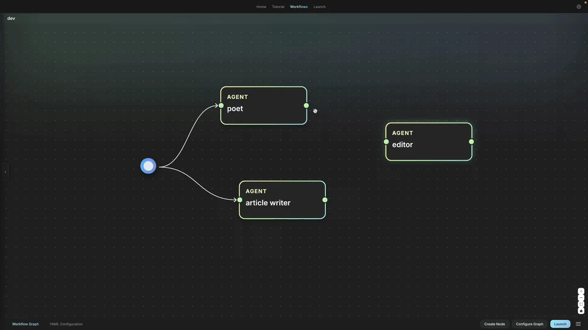
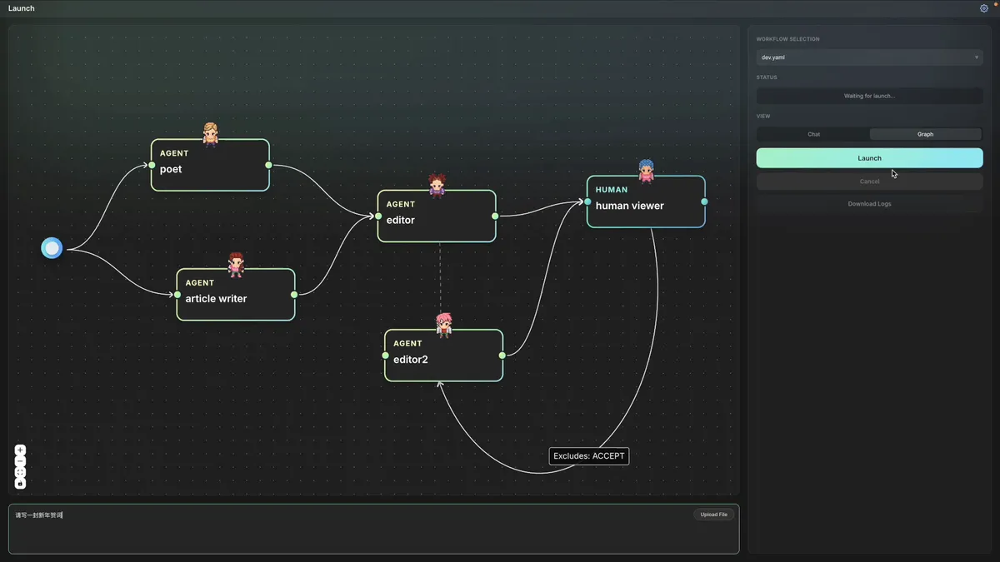
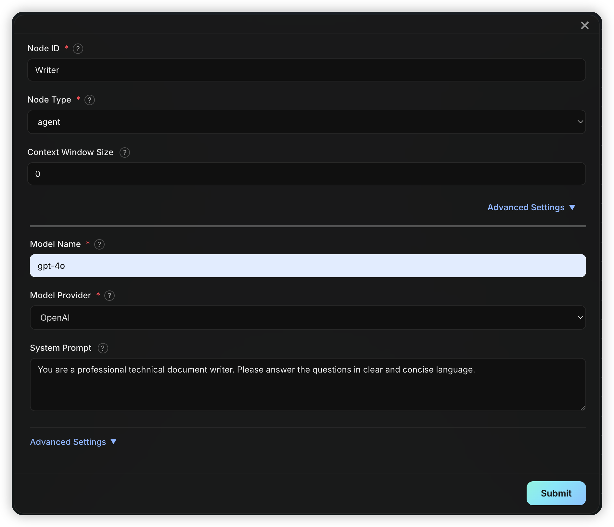
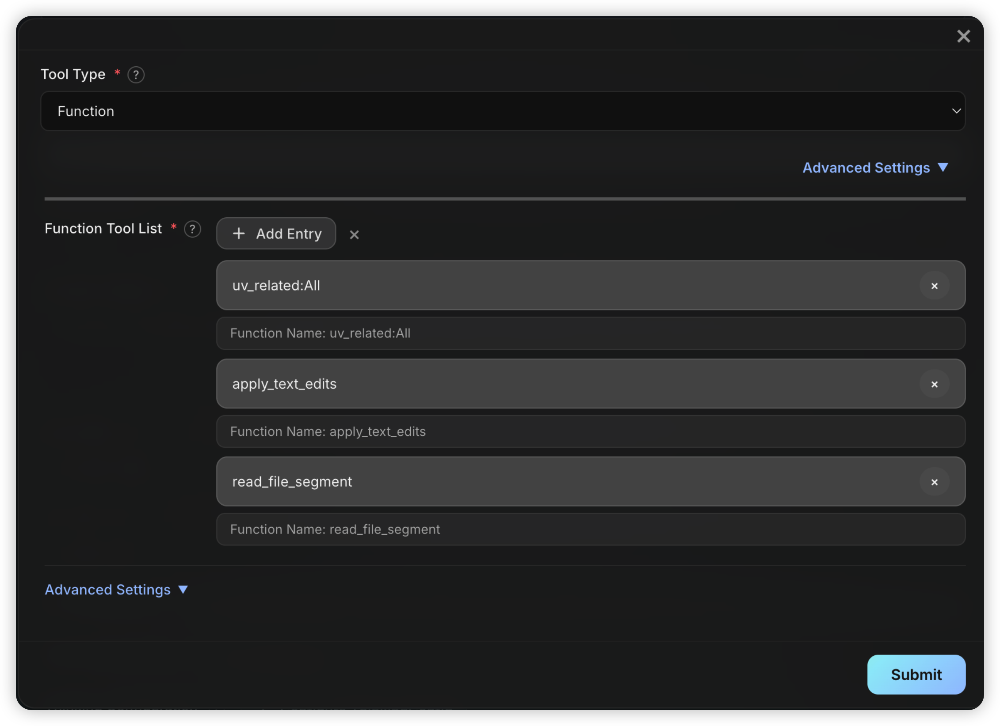
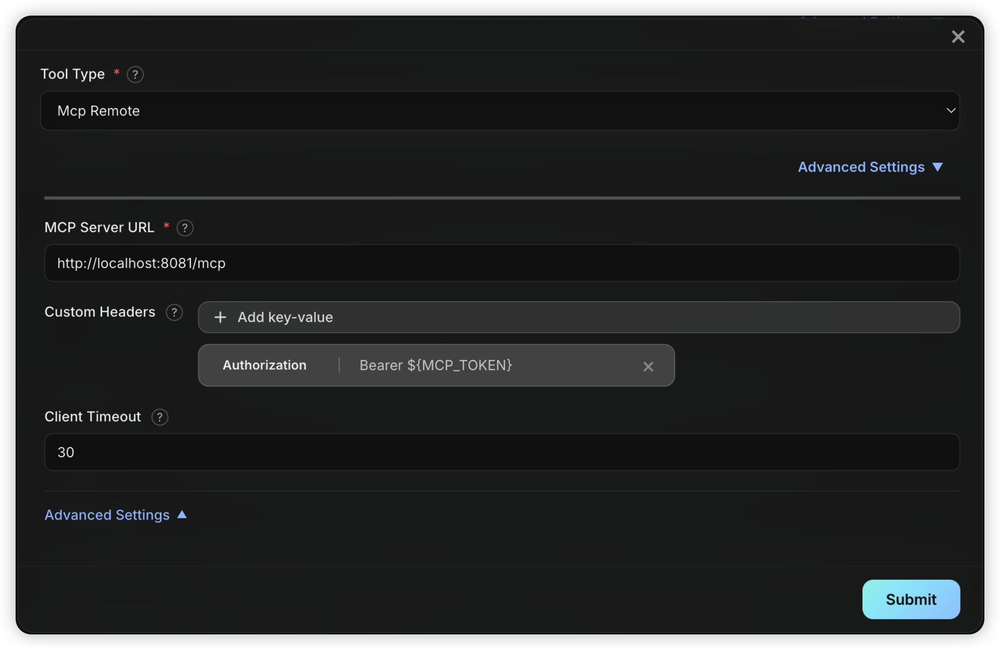
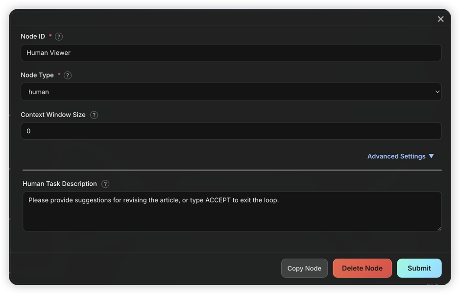
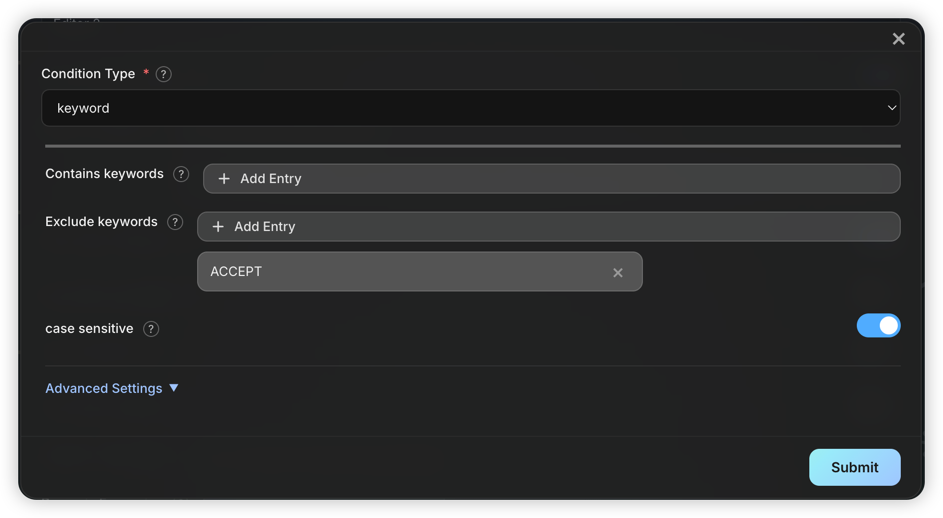
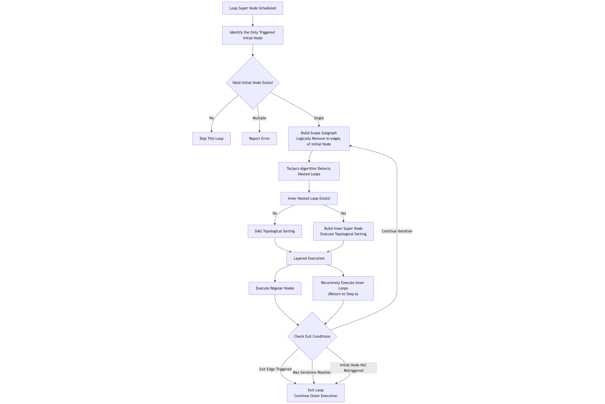
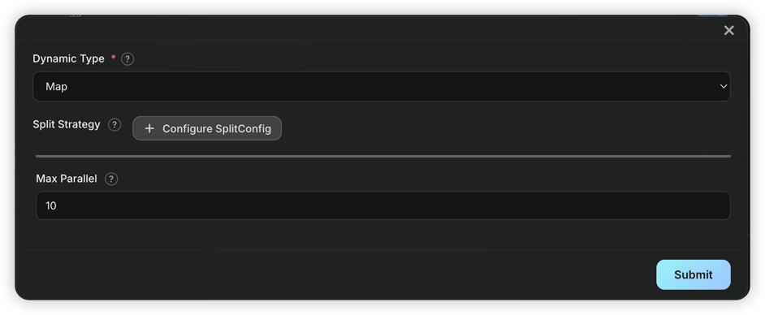

# AgentDev 使用指南

AgentDev 让你搭建一家“AI 公司”：每位员工都是一个**智能体（agent）**，智能体被编排成一个**工作流**，你在聊天窗口中把工作交给整个团队。本指南按照你实际使用应用的顺序编排。

- [1. 基本概念](#concepts)
- [2. 连接你的账号](#connections)
- [3. 技能库](#skill-library)
- [4. 构建工作流](#build-workflow)
  - [创建节点](#2-create-nodes)
  - [用连线连接节点](#what-is-an-edge)
  - [团队负责人与成员](#team-lead)
  - [为智能体添加技能](#attach-skills)
  - [示例：带连线的文章工作流](#example-linked-workflow)
- [5. “软件公司”模板](#software-company)
- [6. 运行工作流](#run-page)
- [7. 实验室](#lab)
- [参考：节点类型](#node-types-explained)
- [参考：连线配置](#edge-configuration)
- [参考：执行逻辑](#graph-execution-logic)
- [参考：动态执行模式](#dynamic-execution-mode)
- [参考：目录结构](#workspace-structure)

---

<a id="concepts"></a>
## 1. 基本概念

| 术语 | 含义 |
|------|---------|
| **工作流（Workflow）** | 一个 YAML 文件，描述一支智能体团队以及它们如何协作。工作流列在侧边栏的 **工作流** 下。 |
| **节点（Node）** | 工作流中的一个步骤。最常见的类型是 **Agent**；此外还有人工、Python、Literal、Passthrough、循环计数器和子图节点。 |
| **连线（Edge）** | 两个节点之间的箭头：它把源节点的输出传给目标节点，并可以触发目标节点运行。 |
| **智能体（Agent）** | 调用 AI 模型（Claude、Codex、Gemini）的节点，拥有自己的角色、提示词、工具和技能。 |
| **团队负责人（Team lead）** | 唯一与你对话的智能体（例如 CTO、PM 或 CEO）。负责人决定何时把工作委派给哪位成员。 |
| **成员（Member）** | 负责人可以委派工作的智能体。通常是一个**没有任何连线**的智能体节点。 |
| **技能（Skill）** | 一个说明文件（SKILL.md），教智能体如何完成某类工作，例如做计划或代码评审。技能存放在共享技能库中。 |
| **连接（Connection）** | 你已登录的 AI 账号（Claude、Codex/ChatGPT、Gemini）。每个智能体都在某一个连接上运行。 |
| **会话（Session）** | **启动** 页面上的一项工作：聊天记录、附件以及（可选的）项目文件夹。 |

---

<a id="connections"></a>
## 2. 连接你的账号

智能体需要一个 AI 账号才能运行。打开 **设置 → 连接**（顶栏右侧的齿轮按钮）。

1. 在 **服务商** 下选择一张服务商卡片，点击 **连接**。
2. 选择登录方式并按对话框操作：
   - **Anthropic Claude**：**使用账号登录**，使用本机上的 Claude CLI。如果本机已经登录，直接点击 **连接** 即可；否则点击 **使用 Claude 账号继续**，打开登录链接并登录，把代码粘贴到 **在此粘贴代码**，然后点击 **确认**。
   - **OpenAI (Codex)**：**使用 ChatGPT 登录**（打开 OpenAI 登录页面；适用于 Plus/Pro/Team 套餐）或 **使用设备码**（获取一个代码并在浏览器中输入，适合浏览器不在服务器所在机器上的情况）。
   - **Google Gemini**：**使用 Google 登录**。服务器需要在 `.env` 中配置 `GOOGLE_OAUTH_CLIENT_ID` 和 `GOOGLE_OAUTH_CLIENT_SECRET`。
3. 新连接会出现在 **我的连接** 下。点击它可以查看账号、**用量**（5 小时会话、每周……）和 **可用模型**。

提示：

- **设为默认**：所有没有单独指定连接的智能体节点都使用默认连接运行。
- **测试**：快速检查连接是否仍然可用。如果运行时出现认证错误，先测试一下。
- 凭据只保存在你的服务器上，绝不会写入工作流文件。
- 如果没有安装 Claude CLI 或 Codex CLI，对话框会提示你先安装。

**账号自动切换。** 当智能体正在使用的账号提示用量已耗尽（例如 Claude 的 5 小时限额）时，AgentDev 会把该智能体切换到另一个已登录的账号，优先选择其他厂商（Claude → Codex，Codex → Claude，然后是 Gemini），并使用该账号的默认模型。聊天中的一行消息和一个弹窗会告诉你由哪个账号接手，同一次运行中后续的智能体会直接使用它。如果没有可用账号了，你会收到一条错误，提示你到 **连接** 页面登录另一个账号，因此建议同时登录 Claude 和 Codex。

---

<a id="skill-library"></a>
## 3. 技能库

打开 **设置 → 技能**。这里是共享技能库：技能只需添加一次，所有智能体都能使用。编辑某个技能会同步更新所有使用它的智能体。

**添加技能**

1. 点击 **添加技能**。
2. 把 SKILL.md 的内容粘贴到 **内容** 中（带不带 `---` frontmatter 都可以），或点击 **上传 .md** / 把 `.md` 文件拖到输入框上（最大 256 KB）。
3. 如果没有 frontmatter，请填写 **名称**（小写字母、数字、`-`）和 **描述：何时使用**。描述很重要：智能体会读取它来决定何时加载该技能。
4. 点击 **保存技能**。如果名称已存在，会询问你是否 **覆盖**。

**从 Claude 导入技能**

如果你在 `~/.claude/skills` 中已有技能，点击 **从 Claude 导入**。**从文件夹导入技能** 对话框会列出找到的技能；勾选需要的技能（或 **全选**），打开 **覆盖已有技能** 以替换旧版本，然后点击 **导入**。你也可以修改 **源文件夹** 并点击 **重新加载**。

每张技能卡片都有 **编辑** 和 **删除**。无法解析的技能会标记为 **格式错误**。

---

<a id="build-workflow"></a>
## 4. 构建工作流

打开侧边栏中的 **工作流**。左侧是列表；点击 **创建工作流** 新建一个，或选择已有的工作流进行编辑。

编辑器有两个标签页：

- **工作流图**：拖放节点和连线。
- **YAML 配置**：直接查看和编辑 YAML 文件。

图上方的工具栏包括：

- **创建节点**：打开节点表单（也可以在画布空白处右键，在该位置创建节点）。
- **配置图**：描述、初始指令、日志级别、记忆、开始和结束节点。
- **启动**：用此工作流打开启动页面。
- 一个菜单（将鼠标悬停在工具栏末尾的图标上）：**重命名工作流**、**复制工作流**、**管理变量**、**管理记忆**、**创建连线**。

在 **设置** 中打开 **启用帮助提示**，鼠标悬停在节点、连线和按钮上时即可看到说明。

<a id="2-create-nodes"></a>
### 创建节点

点击 **创建节点**，选择 **类型** 并填写表单。对于 **Agent** 节点，主要字段有：

| 字段 | 含义 |
|-------|---------|
| **ID** | 唯一的节点名称，例如 `Backend Developer`。负责人通过这个 ID 调用成员。 |
| **描述** | 用一句话说明节点做什么。负责人会读取它来挑选合适的成员，所以要写清楚。 |
| **吉祥物** | 节点在图、启动页面和办公室中的角色形象。 |
| **账户连接** | 调用模型所用的账号。留空则使用默认连接。 |
| **模型** | 从已连接账号的模型中选择，或选择 **输入其他模型名称...** |
| **系统提示词** | 智能体的角色、职责和工作规则。 |
| **Agent 技能** | 从技能库中勾选的技能（见[为智能体添加技能](#attach-skills)）。 |
| **团队负责人** | 让该智能体成为团队负责人（见[团队负责人与成员](#team-lead)）。 |
| **工具集** | 智能体可以使用的工具：读写文件、运行代码、网页搜索、MCP 服务器…… |
| **上下文窗口** | 智能体在多次运行之间保留多少条之前的消息。`-1` 表示不限制。 |

不常用的字段位于表单底部的 **高级设置** 中。点击 **提交** 保存节点，点击 **复制节点** 复制一份（副本需要新的 ID），或点击 **删除节点** 将其连同连线一起删除。

<a id="what-is-an-edge"></a>
### 用连线连接节点

**连线**连接两个节点，作用有两个：

1. **传递数据**：源节点的输出成为目标节点的输入。
2. **控制顺序**：源节点完成后，连线可以触发目标节点运行。

创建连线时，从节点侧边的连接点拖到另一个节点上，或使用菜单中的 **创建连线**。点击连线可以编辑或删除它。

**开始** 节点是工作流的起点：所有与它相连的节点都会收到你的任务，并在工作流启动时并行运行。开始节点必须至少保留一条连线。

关于连线选项（条件、仅传数据的连线、保留消息……），请参阅[参考：连线配置](#edge-configuration)。

<a id="team-lead"></a>
### 团队负责人与成员

除了用连线把步骤顺序固定下来，你还可以组建一支带负责人的**团队**。负责人是唯一与你对话的智能体；工作过程中，它决定委派给哪位成员、委派几次以及按什么顺序，最后为你汇总结果。

设置方法：

1. 为负责人创建一个智能体节点（例如 `CTO`），并把开始节点连到它。
2. 为成员创建智能体节点。**不要给它们连接任何连线**：负责人会在需要时调用它们。写清楚 **描述**，让负责人知道谁负责什么。
3. 打开负责人的表单，配置 **团队负责人** 一项并填写：

| 字段 | 含义 |
|-------|---------|
| **担任团队负责人** | 打开后该智能体成为负责人。 |
| **成员** | 负责人可以委派的智能体节点 ID。留空 = 所有没有连线的智能体节点。 |
| **开工前先确认计划** | 对于新工作，负责人会先提出计划（技术栈、架构、任务）并等待你批准，除非你已说过直接开始。 |
| **每次请求最多委派次数** | （高级）一轮中委派次数的上限，用于控制 token 用量。 |
| **最多修复/评审轮数** | （高级）未通过的工作最多可以退回修复几次，之后负责人会向你报告。 |

运行过程中，如果请求不明确，负责人可以**向你提问**。问题会出现在聊天中，直接回答即可。委派会显示为类似“CTO 把任务分配给了 Backend Developer”和“Backend Developer 向 CTO 汇报”的消息。

<a id="attach-skills"></a>
### 为智能体添加技能

在智能体表单中，**Agent 技能** 列出了整个技能库。勾选该智能体需要的技能，已选数量显示在顶部。点击 **管理技能库** 会在新标签页中添加或编辑技能。只有当任务与技能的“何时使用”描述相符时，智能体才会加载该技能的内容。

<a id="example-linked-workflow"></a>
### 示例：带连线的文章工作流

`demo_loop_counter` 工作流展示了如何用连线串联节点：

1. 创建三个智能体节点：**Poet**（写诗）、**Article Writer**（写文章）和 **Editor 1**（把两者合并）。
2. 把开始节点连到 Poet 和 Article Writer：它们并行运行。
3. 连接 `Poet → Editor 1` 和 `Article Writer → Editor 1`：两份结果都到达后 Editor 1 才运行。



如果要加入评审循环，创建一个 **人工** 节点，提问“请对文章提出意见，或输入 ACCEPT 结束”，然后使用**条件连线**：`ACCEPT` 结束运行，其他任何内容都转到 **Editor 2** 再修改一轮。参见[连线条件](#edge-condition)。



---

<a id="software-company"></a>
## 5. “软件公司”模板

`software_company` 工作流是一家现成的软件公司（网站、Web 应用、桌面应用），由 **CTO** 担任团队负责人，共有 11 名成员：

| 成员 | 主要职责 |
|--------|----------|
| Project Manager | 需求、用户故事、验收标准、任务拆分和排期 |
| Solution Architect | 系统分析、架构、模块边界、API、设计层面的缺陷 |
| Data Engineer | 数据库 schema、迁移、查询、数据完整性和性能 |
| Backend Lead | 后端技术负责人、API 设计、后端代码评审 |
| Backend Developer | 带测试的后端功能和 API |
| Frontend Developer | 页面、组件、状态、API 对接、响应式且无障碍的界面 |
| UI UX Designer | 用户体验流程、布局、设计系统和界面规范 |
| Bug Fixer | 复现缺陷、找出根因并修复，同时补充回归测试 |
| QA Tester | 按验收标准测试，并附带证据报告通过/失败 |
| Acceptance Reviewer | 最终验收：结果是否满足需求并达到质量标准 |
| DevOps Engineer | 构建、CI/CD、环境、部署和监控 |

工作方式：你只和 CTO 对话。对于新项目，CTO 会澄清目标、提出技术栈和架构、拆分工作，并**提交计划供你批准**。你同意后，它会逐步委派：PM → 架构/设计 → 实现 → QA → 验收 → DevOps（当范围包括部署时）。对于已有项目或缺陷报告，CTO 会先阅读代码再挑选合适的人。不需要动手的问题由 CTO 直接回答。

每位成员都配有合适的技能（例如 CTO 使用 `planning-and-task-breakdown` 和 `spec-driven-development`；Acceptance Reviewer 使用 `code-review-and-quality` 和 `security-and-hardening`）。

如需自定义，打开该工作流，使用 **复制工作流** 创建你自己的版本，然后修改模型、账户连接、技能，或增删成员。添加成员只需新建一个没有连线、描述清晰的智能体节点。

---

<a id="run-page"></a>
## 6. 运行工作流

打开侧边栏中的 **启动**（或在工作流编辑器中点击 **启动**）。

**选择工作流和项目**

1. 在右侧面板的 **工作流选择** 下选择工作流（例如 `software_company`）。
2. 如果想让智能体在已有项目上工作，点击会话列表（左侧）底部的 **添加新项目**，或点击输入框旁的 **+** 按钮并选择 **打开项目文件夹**。在 **打开项目文件夹** 对话框中，选择本机上的一个文件夹（或输入路径后按回车），然后点击 **打开文件夹**。智能体会**直接**修改该文件夹中的文件，因此请使用 git 查看和撤销更改。
3. 要附加文件（文档、图片、表格……），点击 **+** → **上传文件**，或把文件拖到聊天区域。

**与负责人对话**

在 **请输入任务提示词...** 中输入任务并点击 **启动**。使用团队负责人工作流时，你可以像与人交谈一样与负责人对话：回答它的问题、批准计划（“好的，开始吧”）或要求修改。当工作流在等你时，状态会显示 **等待你的回复**；输入回答后点击 **发送**。**重新启动** 会从头再运行一次。

左侧列表保存所有**会话**，按项目分组。点击 **新会话** 开始另一个会话；在后台运行的会话完成或需要你回答时仍会通知你。

**视图**（右侧面板的 **视图** 区域）

| 视图 | 显示内容 |
|------|---------------|
| **聊天** | 完整对话、每个智能体的输出、结果文件。 |
| **图** | 工作流图，并高亮正在运行的节点。 |
| **办公室** | 一个 2D 办公室：每个智能体都是坐在所属部门工位上的角色，交接或接收工作时会走动。点击角色可查看其状态、模型和最新输出。 |
| **任务** | 按团队或按步骤显示的任务看板：每个智能体正在做什么、排队中和已完成的工作。 |
| **概览** | 进度、运行时间、模型调用和工具使用、时间线以及最近活动。 |
| **验收** | 接受或拒绝结果（见下文）。 |

**验收结果**

在 **验收** 中，每次完成的运行都会成为一条 **待验收** 项。打开它可以看到你的请求、交付的结果、修改过的文件以及每个智能体的交接说明。为质量打分，选择 **优点** / **需改进**，填写意见，然后点击：

- **验收通过**：结果令人满意时。
- **要求返工**：结果不满意时。打开 **按意见立即交还给智能体团队** 可让团队立即在同一项目中重做（第 2、3……轮）。

**下载日志** 可获取详细的运行日志。

---

<a id="lab"></a>
## 7. 实验室

**实验室** 用于在你正式依赖某个工作流之前对其进行验证。在 **要验证的工作流** 下选择它，然后：

**1. 配置检查**（即时完成，不消耗 token）。每一项都会标为绿色（通过）、琥珀色（警告）或红色（错误）：工作流结构、AI 账号、每个智能体的角色、所选技能是否在技能库中、工具是否存在、代码/命令执行权限、团队负责人和成员，以及永远不会运行的节点。在测试运行前请修复所有红色项。

**2. 测试场景。** 每个场景包含 **发送给工作流的请求**（你实际会输入的内容）和 **通过标准**（回答必须满足的条件；留空表示任何无错误的回答都算通过）。**添加示例场景** 会为软件公司模板填入两个场景。选择 **每个场景运行次数**（运行 2–3 次可衡量稳定性），然后点击 **开始测试**。工作流会真正使用你的账号运行；它提出的问题（例如计划审批）会自动回答“Approved”，并由 AI 评审为每个回答打分并给出理由。

结果显示通过率、token、预估费用、耗时、参与的智能体、提出的问题以及每个回答。当通过率达到 80% 或以上且没有出错的运行时，工作流即为 **通过**。场景按工作流保存在你的浏览器中，所以修改工作流后只需再次运行即可。

**从 Excel/CSV 批量运行。** 顶部的按钮会打开批量运行页面：

1. 在 **选择工作流** 下选择工作流。
2. 在 **选择输入文件** 下选择一个 `.xlsx` 或 `.csv` 输入文件。它至少需要 `task` 和/或 `attachments` 列：
   - `id`：唯一的行 ID（如果没有该列会自动生成）
   - `task`：任务文本
   - `vars`：全局变量的 JSON 对象
   - `attachments`：附件绝对路径的 JSON 数组
3. 设置 **最大并发数** 和日志级别，然后点击 **启动**。
4. 在 **仪表盘** 或 **终端** 视图中查看进度；完成后点击 **下载日志**。

---

<a id="node-types-explained"></a>
# 参考：节点类型

<a id="agent-node"></a>
## Agent 节点

主要的节点类型。它调用 AI 模型来写作、编码、分析和决策。智能体可以使用工具、记忆和技能，也可以担任团队负责人。



### 工具

在 **工具集** 下，你可以同时添加多个工具来源：

**1. 本地 Python 函数（function）**：位于 `workspace/functions/function_calling/` 中的函数。像 `file:All` 这样的条目会加载 `file.py` 中的所有函数；其他条目只加载单个函数。



| 模块 | 主要函数 | 用途 |
|--------|----------------|---------|
| `file.py` | `save_file`、`read_file_segment`、`list_directory`、`search_in_files`... | 读写项目文件 |
| `code_executor.py` | `execute_code` | 运行代码 |
| `shell.py` | `run_shell_command` | 在项目文件夹中运行命令（`npm test`、`npm run build`、`pytest`…） |
| `uv_related.py` | `install_python_packages`、`init_python_env`、`uv_run` | Python 环境管理 |
| `web.py` | `web_search`、`read_webpage_content` | 网页搜索和页面读取 |
| `deep_research.py` | `search_save_result`、`report_*` 系列函数 | 调研和撰写报告 |
| `user.py` | `call_user` | 向用户提问 |
| `utils.py` | `get_current_time`、`wait` | 实用工具 |

添加自定义函数：在 `workspace/functions/function_calling/` 中创建一个 Python 文件，为参数添加注解，编写 docstring（模型会读取它），然后重启后端。

```python
from typing import Annotated
from agentdev.utils.function_catalog import ParamMeta

def my_tool(
    param1: Annotated[str, ParamMeta(description="Parameter description")],
    *,
    _context: dict | None = None,  # optional, injected by the system, hidden from the model
) -> str:
    """Function description (shown to the model)"""
    return "result"
```

**2. MCP 服务器**：`mcp_remote` 通过 HTTP 连接 MCP 服务器；`mcp_local` 通过 stdio 启动本地 MCP 服务器（例如 `uvx ...`）。



### 记忆

1. 打开菜单 → **管理记忆**，添加一个记忆存储：

| 类型 | 行为 | 适用场景 |
|------|-----------|---------|
| `simple` | 存储之前的结果，按关键词检索（无需 API key）；可选使用本地嵌入模型 | 对话记忆 |
| `file` | 为本地文件/文件夹建立索引，只读 | 知识库 |
| `blackboard` | 多个节点共同读写的共享看板，仅在当前运行中有效 | 在节点之间共享信息 |

2. 在智能体节点中打开 **记忆**，选择存储，设置读写权限和检索阶段。

示例：`workspace/workflows/demo_simple_memory.yaml`。

<a id="human-node"></a>
## 人工节点

暂停工作流并等待你的输入：评审、意见、决策或补充信息。它的任务描述就是展示给你的问题。



> 使用团队负责人工作流时很少需要这个节点：负责人会在需要时亲自问你。

<a id="python-node"></a>
## Python 节点

在本机上运行 Python 代码。该节点从输入中提取 ```` ```python ... ``` ```` 代码块（如果没有则使用整个输入），在会话的 `code_workspace/` 文件夹中运行，并把 stdout 传给下游。你可以设置环境变量、启动参数和超时时间。

出于安全考虑，Python 执行默认处于禁用状态。如果你信任该工作流，请在 `.env` 中设置 `MAC_ALLOW_UNSAFE_CODE_EXECUTION=1` 并重启后端（代码会直接运行，没有沙箱）。同一个开关也会启用 `run_shell_command`；它只在项目文件夹内运行，并会拦截危险命令，例如清空磁盘、`git push` 或 `npm publish`。你在聊天中附加的图片和 PDF 会传给智能体（Claude 用它的 Read 工具打开，Codex 直接接收图片）；较小的文本文件会被放入提示词中。

<a id="passthrough-node"></a>
## Passthrough 节点

只转发消息，不做其他事情。默认只转发最后一条消息（可通过 **仅最后一条消息** 修改）。常见用途：在循环中保留原始任务（配合连线上的 **保留消息输入**），或过滤掉多余的循环输出。

<a id="literal-node"></a>
## Literal 节点

输出一段固定文本并忽略输入；消息角色可以是 `user` 或 `assistant`。可用于注入固定指令或测试下游节点。

<a id="loop-counter-node"></a>
## 循环计数器节点

限制循环运行的次数。每次被触发计数加 1；达到最大值之前该节点不输出任何内容，达到后发出放行消息以退出循环。请把它同时连接到循环内的一个节点和循环外的一个节点。**循环计时器** 节点的工作方式相同，只是基于时间。

示例：`workspace/workflows/demo_loop_counter.yaml`。

<a id="subgraph-node"></a>
## 子图节点

嵌入另一个工作流以便复用。来源类型为 `file`（相对于 `workspace/workflows/` 的 YAML 路径）或 `config`（内联定义）。子图继承父工作流的变量；由它的结束节点决定返回什么。

示例：`workspace/workflows/software_company.yaml`、`workspace/workflows/marketing_agency.yaml`。

---

<a id="edge-configuration"></a>
# 参考：连线配置

| 字段 | 默认值 | 含义 |
|-------|---------|---------|
| **条件** | 始终为真 | 只有条件为真时连线才生效 |
| **触发器** | 开 | 关闭时：连线只传递数据，不会让目标节点运行 |
| **向目标传递数据** | 开 | 关闭时：只触发，不传递数据 |
| **保留消息输入** | 关 | 目标节点裁剪上下文时不会移除该消息 |
| **清除上下文** | 关 | 在传入新数据前清除目标节点中未保留的上下文 |
| **清除保留的上下文** | 关 | 同时清除保留的消息 |
| **负载处理器** | - | 在传递前转换内容（正则、自定义函数） |
| **动态展开** | - | 参见[动态执行模式](#dynamic-execution-mode) |

<a id="edge-condition"></a>
## 连线条件

- **关键词**（`keyword`）：包含关键词、排除关键词、正则表达式。排除规则优先。
- **函数**（`function`）：位于 `workspace/functions/edge/` 中的函数，例如 `true`（始终）、`code_pass`、`code_fail`、`always_false`。



<a id="payload-processor"></a>
## 负载处理器

- `regex_extract`：使用 Python 正则提取（模式、捕获组、使用 `{match}` 的输出模板、未匹配时的行为：`pass` / `default` / `drop` / `empty`）。
- `function`：调用 `workspace/functions/edge_processor/` 中的函数，例如 `uppercase_payload`、`code_save_and_run`。

添加新的条件函数或处理器函数后需重启后端。

---

<a id="graph-execution-logic"></a>
# 参考：执行逻辑

<a id="dag-execution"></a>
## 无循环的工作流

节点按依赖关系排序（拓扑排序）。没有需要等待的依赖的节点先运行；同一层的节点并行运行。

<a id="loop-graph-execution"></a>
## 有循环的工作流

AgentDev 使用 Tarjan 算法找出循环，把每个循环封装成一个“超级节点”，然后像无循环工作流一样运行。在每个循环内部：

1. 找到唯一一个从外部触发的入口节点（多于一个属于配置错误）。
2. 暂时去掉指向入口节点的连线以找出嵌套循环，然后逐层递归运行。
3. 当离开循环的连线被触发、达到最大轮数（默认 100）或入口节点不再被触发时退出循环。



> 团队负责人工作流不需要循环：负责人会自行把未通过的工作退回修复，最多 **最多修复/评审轮数** 次。

---

<a id="dynamic-execution-mode"></a>
# 参考：动态执行模式

在连线上配置（**动态展开**），把数据拆分成多份并行运行目标节点：

| 模式 | 运行方式 | 输出 |
|------|-------------|--------|
| **Map** | 拆分后并行运行 | 结果列表 |
| **Tree** | 拆分后并行运行，再分多轮合并 | 单个结果 |

**拆分策略**：`message`（每条消息一份，默认）、`regex`（每个正则匹配一份）、`json_path`（每个 JSON 数组元素一份）。通过普通（非动态）连线到达的消息会被复制到每一个并行运行中。



---

<a id="workspace-structure"></a>
# 参考：目录结构

| 路径 | 内容 |
|------|----------|
| `workspace/workflows/` | 工作流 YAML 文件 |
| `workspace/skills/` | 共享技能库 |
| `workspace/functions/` | 工具函数、连线条件函数和处理器函数 |
| `storage/warehouse/<session>/` | 单个会话的数据 |
| `storage/warehouse/<session>/code_workspace/` | 代码和上传文件的工作文件夹（`attachments/`） |
| `storage/warehouse/<session>/execution_logs.json` | 执行日志 |
| `storage/warehouse/<session>/node_outputs.yaml` | 每个节点的输出 |
